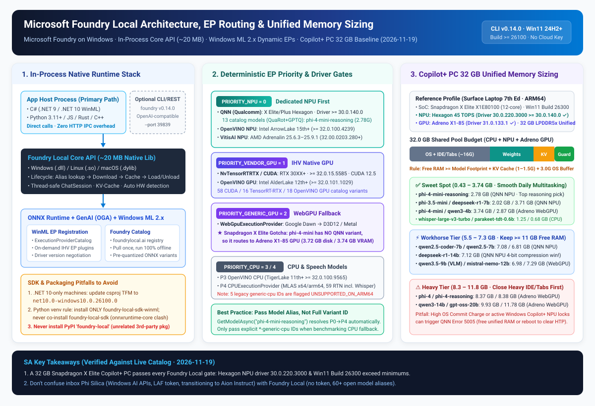
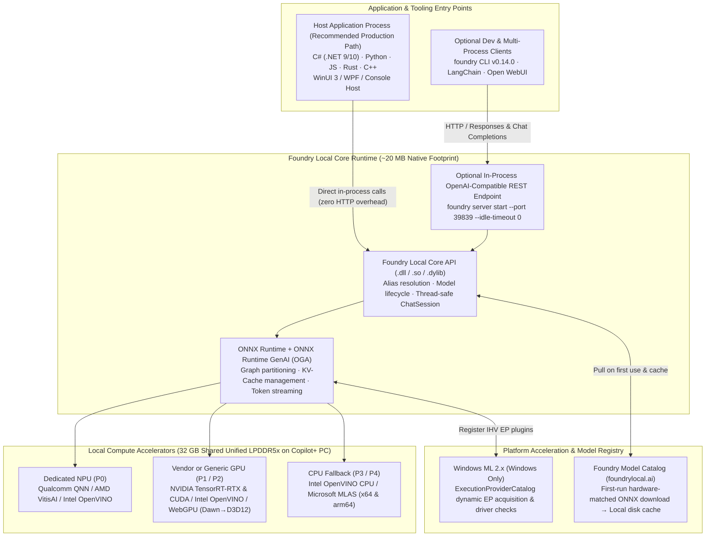
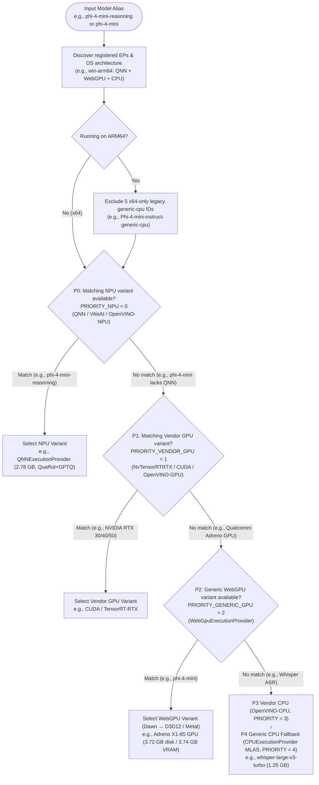

# Microsoft Foundry Local: On-Device AI Architecture, Hardware Readiness & Decision Guide

[中文](foundry-local-on-device-ai-guide.md) | [Repository home](README.en.md) | [Interactive Hardware & Unified Memory Sizer](workshops/foundry-local/sizer.en.html) | [Claude Workshop guide](claude-on-foundry-workshop-guide.en.md) | [Existing AOAI manual (Chinese)](azure-foundry-aoai-guide.md)

> **Verification baseline & privacy notice (2026-11-19):** Synthesized from official Microsoft Learn documentation (Windows AI and Microsoft Foundry Local) and the live `foundrylocal.ai/api/models` catalog snapshot verified on **2026-11-19**. All hardware readiness analysis is framed against a standardized, anonymized **Copilot+ PC Reference Profile (Microsoft Surface Laptop 7th Edition · Snapdragon X Elite X1E80100 12-core · Hexagon NPU 45 TOPS driver `30.0.220.3000` · Adreno X1-85 GPU driver `31.0.133.1` · 32 GB Unified LPDDR5x · Windows 11 Build `26300` · .NET 10 ARM64 & Python 3.12 ARM64)**—no personal OS usernames, local filesystem paths, or active process names are included. Every disk footprint, VRAM/unified-memory figure, driver threshold, and catalog count comes directly from verified sources with zero fabricated metrics.

## Navigation

[1. Executive summary & Copilot+ PC readiness](#executive-summary) · [2. Architecture & deterministic EP priority routing](#architecture) · [3. Core technical FAQ (Q1–Q8)](#faq) · [4. Scenario & model selection decision matrix](#decision-matrix) · [5. Pre-flight verification checklist](#checklist) · [6. Sources & verification scope](#sources)

---

<a id="executive-summary"></a>
## 1. Executive summary & Copilot+ PC readiness

When evaluating **"Does a modern Windows 11 / Copilot+ PC meet the requirements for Foundry Local, and can it run models smoothly?"**, the engineering verdict is: **Yes—with full NPU + GPU + CPU hardware acceleration on a 32 GB Snapdragon X Elite Copilot+ PC.** However, production-grade adoption requires navigating three critical nuances: **model-to-EP catalog routing (`phi-4-mini` vs `phi-4-mini-reasoning`), unified memory commit pressure (OS Commit Charge), and `.NET 10` / Python package isolation.**

### 1.1 Copilot+ PC Reference Profile readiness scorecard

| Dimension | Official Foundry Local minimum gate | Copilot+ PC Reference Profile baseline | Status | Key engineering note |
| --- | --- | --- | --- | --- |
| **Operating system** | Windows 11, version 24H2 (`Build 26100`) or later | Windows 11 `Build 26300` (`win-arm64`) | **PASS** | Enables on-demand dynamic EP downloads via Windows ML `ExecutionProviderCatalog` |
| **Qualcomm NPU (`QNN`)** | Snapdragon X Elite (`X1Exxxxx`) / X Plus (`X1Pxxxxx`), Hexagon NPU driver `>= 30.0.140.0` | Snapdragon X Elite `X1E80100` (12-core), Hexagon 45 TOPS driver `30.0.220.3000` | **PASS** | Runs all **13** `QNNExecutionProvider` (`QuaRot + GPTQ`) catalog models natively on NPU |
| **GPU acceleration (`WebGPU`)** | Physical Direct3D 12 GPU with up-to-date drivers | Qualcomm Adreno X1-85 GPU, driver `31.0.133.1` | **PASS** | Translates WebGPU → Dawn → D3D12 for **43** `WebGpuExecutionProvider` (`RTN`) models |
| **Unified memory pool** | Enough free RAM/VRAM and disk space for the selected variant + KV cache | **32 GB** Unified LPDDR5x (shared across CPU, Hexagon NPU, and Adreno GPU) | **PASS** | `0.43–3.74 GB` models coexist effortlessly with daily apps; `7–10 GB` models require free-headroom discipline |
| **.NET SDK & Runtime** | `.NET 9.0+` SDK (WinML quickstart defaults to `net9.0-windows10.0.26100.0`) | `.NET 10` ARM64 SDK/Runtime installed without `.NET 9` runtime | **Update TFM** | Change `<TargetFramework>` in `.csproj` to `net10.0-windows10.0.26100.0` to build and run cleanly |
| **Python runtime** | Python `3.11+` + `foundry-local-sdk-winml` | Python `3.12` ARM64 | **PASS** | Install **only** `foundry-local-sdk-winml` inside an isolated `venv`; never co-install `foundry-local-sdk` |
| **Optional CLI & server** | `Microsoft.FoundryLocal` `v0.14.0.0` + `Microsoft.VCLibs.Desktop.14 >= 14.0.33728.0` | Native `foundry-0.14.0-win-arm64.msix` installer supported | **PASS** | In-process SDK apps do **not** require the CLI; install only for terminal ops or local OpenAI REST endpoints |

### 1.2 Four headline architectural findings

1. **Embedded native runtime, not a mandatory background daemon:** Foundry Local ships inside your application as an in-process native Core API library adding **`~20 MB`** to your package over ONNX Runtime, ONNX Runtime GenAI (OGA), and Windows ML. It requires **no Azure subscription, no API key, and no Limited Access Feature (LAF) unlock token**, running **100% offline** once the initial model and EP download finishes.
2. **Why `phi-4-mini` targets Adreno GPU instead of Hexagon NPU on Snapdragon X Elite:** In the live `2026-11-19` catalog, Microsoft Learn's default quickstart alias `phi-4-mini` (instruct) has **no `QNNExecutionProvider` variant**, so on Snapdragon X Elite it automatically resolves to **`WebGpuExecutionProvider`** on the Adreno X1-85 GPU (`3.72 GB` disk / `3.74 GB` VRAM). By contrast, **`phi-4-mini-reasoning` (`2.78 GB`)** ships a precompiled QNN variant and executes directly on the Hexagon 45 TOPS NPU.
3. **32 GB installed RAM does not mean 32 GB available for model weights:** On unified-memory PCs, CPU processes, NPU `EpContext` buffers, and D3D12 GPU allocations share one physical pool governed by the Windows OS Commit Limit. When browsers, IDEs, and containers hold 18–22 GB of committed memory, loading an `8–10 GB` model can trigger allocation failures or **QNN error `5005`**. Use the companion [Interactive Hardware Readiness & Unified Memory Sizer](workshops/foundry-local/sizer.en.html) to check exact headroom before loading.
4. **Separate `Phi Silica` from `Foundry Local`:** Windows inbox `Phi Silica` is accessed via **Windows AI APIs** and remains a Limited Access Feature requiring an unlock token (scheduled to be replaced by token-free `Aion Instruct`). **Foundry Local** requires no unlock token and exposes 60+ open-model aliases across any Windows 11 24H2+ PC (plus macOS Apple Silicon and Linux).



---

<a id="architecture"></a>
## 2. Architecture & deterministic EP priority routing

### 2.1 In-process native runtime vs optional CLI/REST server



### 2.2 Deterministic alias-to-variant EP priority ladder

When your code requests a **model alias** (such as `catalog.GetModelAsync("phi-4-mini-reasoning")` or `foundry chat phi-4-mini`), Foundry Local filters out incompatible architecture variants and picks the highest-priority hardware variant across five deterministic tiers (`0` highest to `4` fallback):



---

<a id="faq"></a>
## 3. Core technical FAQ (Q1–Q8)

### Q1: How do Windows AI APIs (Phi Silica), Foundry Local, Windows ML, and cloud Microsoft Foundry fit together?

Between 2024 and 2026, Microsoft consolidated its client AI stack under the umbrella brand **Microsoft Foundry on Windows**. Solution Architects can map the four options along a spectrum of **turnkey simplicity vs pipeline control**:

| Tier | Current official name | Model source & hardware reach | Access tokens & billing | Best-fit scenario |
| --- | --- | --- | --- | --- |
| **Tier 1: OS-inbox turnkey APIs** | **Windows AI APIs** (formerly Copilot Runtime APIs) | Microsoft-shipped inbox models (**Phi Silica**, OCR, Image Super Resolution, semantic search); primarily **Copilot+ PCs** (select APIs run on supported discrete GPUs) | Zero token cost; **Note: `Phi Silica` remains a Limited Access Feature (LAF) requiring an unlock token and is scheduled to be replaced by token-free `Aion Instruct`** | Zero app-bundle growth for lightweight text summarization, rewrite, or inbox vision features on supported Windows 11 PCs |
| **Tier 2: Curated on-device open models** | **Foundry Local** (part of Microsoft Foundry on Windows) | Curated catalog (**60+ model aliases / 220+ hardware variants** across Phi-4, Qwen2.5/3/3.5, DeepSeek-R1, Mistral, Whisper); runs on **any Windows 11 24H2+ PC**, macOS Apple Silicon, and Linux | **No unlock token, no Azure subscription**, zero per-token cost; network needed only for first-run model/EP download | Shipping apps that need specific open SLMs (coding, reasoning, VLM, ASR, embeddings), cross-hardware reach, strict data locality, or OpenAI-compatible APIs |
| **Tier 3: Bring-your-own ONNX engine** | **Windows ML (new 2.x)** (NuGet package replacing legacy inbox WinRT Windows ML) | **Bring your own ONNX model (BYOM)** with full control over tokenization, pre/post-processing, and `ExecutionProviderCatalog` | Free SDK (subject to IHV execution-provider license terms) | Custom domain vision, anomaly detection, or proprietary ONNX models needing low-level graph & EP control |
| **Tier 4: Cloud frontier platform** | **Microsoft Foundry** (cloud platform—separate product & team, shared brand family) | Cloud-hosted frontier models (GPT-4o, Claude, MAI, managed multi-agent orchestration) | Requires Azure subscription; billed per token or hosted compute | Long-context synthesis, multi-user concurrency, enterprise server-side MCP tools, or cloud fallback when local hardware is constrained |

**Terminology decoder highlights:**
- **Windows Copilot Runtime (2024)** and **Windows AI Foundry (2025)** are retired umbrella names for **Microsoft Foundry on Windows**.
- **DirectML** is retained in Windows ML 2.x only as a legacy GPU provider and **is not an NPU execution path**; cross-vendor GPU acceleration in Foundry Local uses `WebGpuExecutionProvider` (via Google Dawn) alongside vendor-native EPs.

---

### Q2: Is Foundry Local a background web daemon like Ollama, and what is inside the `~20 MB` runtime?

**No.** Foundry Local is primarily an **in-process native library and SDK** that ships directly inside your application; the CLI and local HTTP server are optional developer/integration conveniences.

1. **Primary embedded path (in-process SDK):**
   - Your C# (WinUI 3, WPF, console), Python, JavaScript, Rust, or C++ host loads the native Foundry Local Core API (`.dll` on Windows, `.so` on Linux, `.dylib` on macOS), adding **`~20 MB`** to your application package.
   - Calls execute directly in-process over ONNX Runtime and ONNX Runtime GenAI (OGA) with **zero loopback HTTP overhead, no port collisions, and no background service for end users to manage**.
2. **Optional developer & multi-process path (CLI + OpenAI-compatible server):**
   - For terminal experimentation or HTTP frameworks such as LangChain and Open WebUI, install the preview CLI `Microsoft.FoundryLocal` (verified version **`v0.14.0.0`**, distributed as `foundry-0.14.0-win-arm64.msix` / `win-x64.msix`, requiring `Microsoft.VCLibs.Desktop.14 >= 14.0.33728.0`).
   - Run a persistent fixed-port endpoint via `foundry server start --port 39839 --idle-timeout 0`, supporting both Chat Completions and the **OpenAI Responses API** format.
3. **Single-user client scope boundary:**
   - Foundry Local is engineered for **single-user client devices** (automatic hardware detection, single-session KV-cache management, on-demand load/unload). It does **not** implement multi-user request queuing, continuous batching, or multi-GPU tensor parallelism.
   - For concurrent multi-user server workloads, use **vLLM** or **Triton Inference Server**—or evaluate **Foundry Local on Azure Local** for Kubernetes/Azure Arc-managed private infrastructure.

---

### Q3: What are the exact Execution Provider (EP) priority tiers and minimum driver versions?

On Windows 11 24H2 (`Build 26100`)+, `Microsoft.AI.Foundry.Local.WinML` (C#) and `foundry-local-sdk-winml` (Python) integrate with Windows ML to acquire and register hardware-matched EPs dynamically on first run:

| Priority | Execution Provider (`EpName`) | Supported hardware | Verified minimum driver & software gate | Delivery & licensing notes |
| --- | --- | --- | --- | --- |
| **`0` (Highest)** | `QNNExecutionProvider` (Qualcomm) | Snapdragon X Elite (`X1Exxxxx`) & X Plus (`X1Pxxxxx`) Hexagon NPU | Qualcomm Hexagon NPU driver **`>= 30.0.140.0`** (Reference PC has `30.0.220.3000` -> PASS) | Dynamic WinML download; subject to Qualcomm Neural Processing SDK license |
| **`0` (Highest)** | `OpenVINOExecutionProvider` (Intel NPU) | Intel Core Ultra 15th Gen (`ArrowLake`) and newer NPU | Intel NPU driver **`>= 32.0.100.4239`** | Dynamic WinML download; install Intel NPU driver for Windows |
| **`0` (Highest)** | `VitisAIExecutionProvider` (AMD NPU) | AMD Ryzen AI series NPU | Adrenalin **`25.6.3–25.9.1`**, NPU driver **`32.00.0203.280–32.00.0203.297`** | Dynamic WinML download; note the bounded supported driver range |
| **`1`** | `NvTensorRTRTXExecutionProvider` / `CUDAExecutionProvider` (NVIDIA) | NVIDIA GeForce **RTX 30XX** series and newer GPUs | Windows GPU driver **`>= 32.0.15.5585`** + **CUDA `12.5`** | CUDA built-in / TensorRT-RTX dynamic download; NVIDIA SDK EULA applies |
| **`1`** | `OpenVINOExecutionProvider` (Intel GPU) | Intel 12th Gen (`AlderLake`) and newer integrated / Arc GPUs | Intel GPU driver **`>= 32.0.101.1029`** | Dynamic WinML download; Intel OBL Commercial Use License |
| **`2`** | `WebGpuExecutionProvider` (Generic GPU) | Any Direct3D 12-capable Windows GPU (Qualcomm Adreno, AMD, Intel, NVIDIA) & macOS Apple Silicon | Current DX12 driver (Reference PC Adreno `31.0.133.1` -> PASS) | Powered by Google Dawn (`WebGPU → Dawn → D3D12` on Windows; `Dawn → Metal` on macOS) |
| **`3`** | `OpenVINOExecutionProvider` (Intel CPU) | Intel 11th Gen (`TigerLake`) and newer x64 CPUs | Driver **`>= 32.0.100.9565`** | Dynamic WinML download |
| **`4` (Fallback)** | `CPUExecutionProvider` (Generic CPU) | Any `x64` or `arm64` processor | Built-in **Microsoft MLAS** (no special driver gate) | Always present; primary Windows ARM64 path for Whisper/Parakeet/Nemotron ASR models |

> **Note:** Windows ML 2.x also introduces `AMDGPUExecutionProvider` (Adrenalin `24.12.1+`) while deprecating `MIGraphXExecutionProvider` (not supported for GenAI workloads).

---

### Q4: Why does `phi-4-mini` run on Adreno WebGPU instead of Hexagon NPU on Snapdragon X Elite, whereas `phi-4-mini-reasoning` runs on NPU?

This is the single most important catalog insight when testing on a Snapdragon Copilot+ PC:
- **EP selection depends on which precompiled variants exist in the catalog for that alias.** Qualcomm's Hexagon HTP NPU requires models quantized with `QuaRot + GPTQ` and compiled for QNN context execution. In the verified `2026-11-19` `foundrylocal.ai/api/models` catalog, `phi-4-mini` (instruct) ships VitisAI NPU, OpenVINO NPU/GPU, CUDA, WebGPU, and CPU variants—but **does not currently ship a `QNNExecutionProvider` variant**.
- Consequently, requesting `phi-4-mini` on Snapdragon X Elite skips `P0 (QNN)` and `P1 (Vendor GPU)` and lands on `P2`: **`WebGpuExecutionProvider`** on the Adreno X1-85 GPU (**`3.72 GB`** disk / **`3.74 GB`** VRAM). Meanwhile, its legacy `Phi-4-mini-instruct-generic-cpu` variant is explicitly listed in `UNSUPPORTED_ON_ARM64` so ARM64 devices never accidentally pull an incompatible x64 CPU build.
- By contrast, requesting **`phi-4-mini-reasoning`** immediately matches `P0 (QNNExecutionProvider)` (**`2.78 GB`**, `QuaRot + GPTQ`), offloading 100% of inference onto the 45 TOPS Hexagon NPU while leaving the CPU and Adreno GPU free.

#### Verified live catalog breakdown (`foundrylocal.ai/api/models`, 2026-11-19)

1. **`QNNExecutionProvider` — 13 native Qualcomm Hexagon NPU models (`QuaRot + GPTQ` quantized):**
   - **Compact (`<= 2.1 GB`):** `qwen2.5-0.5b` (`0.43 GB`), `qwen2.5-coder-0.5b` (`0.43 GB`), `qwen2.5-1.5b` (`1.06 GB`), `qwen2.5-coder-1.5b` (`1.06 GB`), `deepseek-r1-1.5b` (`1.52 GB`), `phi-3.5-mini` (`2.02 GB`).
   - **Mid-size reasoning & chat (`2.7 – 3.8 GB`):** `phi-4-mini-reasoning` (`2.78 GB`), `phi-3-mini-4k` (`3.54 GB`), `phi-3-mini-128k` (`3.54 GB`), `deepseek-r1-7b` (`3.71 GB`).
   - **7B–14B workhorse tier (`6.8 – 7.2 GB`):** `qwen2.5-7b` (`6.81 GB`), `qwen2.5-coder-7b` (`7.08 GB`), `deepseek-r1-14b` (`7.12 GB` — over 3 GB smaller in unified memory than its `10.27 GB` WebGPU counterpart thanks to 4-bit QNN quantization!).

2. **`WebGpuExecutionProvider` — 43 cross-vendor GPU models (`RTN` quantized; Adreno DX12 / discrete GPU / Apple Silicon):**
   - **Chat & reasoning:** `qwen3-0.6b` (`0.52 GB`), `qwen3-1.7b` (`1.39 GB`), `smollm3-3b` (`2.20 GB`), `qwen3-4b` (`2.87 GB`), `phi-4-mini` (`3.72 GB` disk / `3.74 GB` VRAM), `deepseek-r1-8b` (`5.79 GB`), `qwen3-8b` (`6.00 GB`), `mistral-nemo-12b-instruct` (`7.29 GB`), `phi-4` (`8.37 GB`), `phi-4-reasoning` (`8.38 GB`), `qwen3-14b` (`9.93 GB`).
   - **Vision-Language (multimodal chat):** `qwen3.5-0.8b` (`1.45 GB`), `qwen3.5-2b` (`2.97 GB`), `ministral-3-3b-instruct-2512` (`3.59 GB`), `qwen3.5-4b` (`4.09 GB`), `gemma-4-e2b-it` (`6.87 GB`), `qwen3.5-9b` (`6.98 GB`).
   - **Embeddings, decision & ranking:** `qwen3-embedding-0.6b` (`0.50 GB`), `qwen3-embedding-8b` (`6.00 GB`), `kev-0.8b` (`1.21 GB`), `kev-4b` (`5.54 GB`), `clm-v0.1-8b` (`8.34 GB`).

3. **`CPUExecutionProvider` — 59 MLAS CPU models (`RTN` quantized):**
   - Adds local speech transcription (ASR): `whisper-tiny` (`0.13 GB`), `whisper-base` (`0.20 GB`), `whisper-small` (`0.43 GB`), `parakeet-tdt-0.6b-v2` (`0.68 GB`), `nemotron-3.5-asr-streaming-0.6b` (`0.74 GB`), `whisper-medium` (`0.92 GB`), and `whisper-large-v3-turbo` (`1.25 GB`). (Note: CUDA GPU variants are also published for x64 NVIDIA PCs.)
   - **ARM64 exclusion guardrail:** Five legacy generic-CPU variants (`Phi-4-mini-instruct-generic-cpu` and `deepseek-r1-distill-{qwen-1.5b,qwen-7b,llama-8b,qwen-14b}-generic-cpu`) are flagged `UNSUPPORTED_ON_ARM64` and skipped automatically on Snapdragon systems.

---

### Q5: Why can a 32 GB Copilot+ PC still hit memory errors on 8–10 GB models, and how should unified memory be sized?

Unlike desktop workstations where discrete GPU VRAM (e.g., 16 GB GDDR6X) is physically separate from 32 GB of system RAM, **Copilot+ PCs use a Unified Memory Architecture (UMA)**:

1. **Shared physical pool:** Windows kernel, DWM desktop composition, security agents, IDEs, browser tabs, WSL2/containers, Hexagon NPU `EpContext` allocations, and Adreno D3D12 shared GPU buffers all draw from the **same 32 GB LPDDR5x pool**.
2. **OS Commit Charge ceiling & contiguous buffer pressure:** Even if Task Manager reports several gigabytes of "Available" cached RAM, high system-wide **Committed** memory (approaching `Physical RAM + Pagefile`) or fragmented physical pages can prevent Windows ML / QNN / D3D12 from pinning large contiguous accelerator buffers—surfacing as **`Qnn error code 5005`** on NPU or empty responses / session creation failures on GPU.
3. **Practical SA sizing formula:**

$$\text{Recommended Free Unified RAM} \ge \text{Model Runtime Footprint} + \text{KV Cache \& Activations (1.0–1.5 GB)} + \text{OS Commit Guard Band (3.0 GB)}$$

| Unified RAM tier | Typical free RAM under office/dev load | Effortless daily resident ceiling | Peak ceiling (after closing heavy IDE/browser tabs) | Recommended daily driver lineup |
| --- | --- | --- | --- | --- |
| **16 GB Copilot+ PC** | `4.5 – 6.5 GB` | Footprint `<= 2.2 GB` | Footprint `<= 3.8 GB` | `phi-3.5-mini` (`2.02 GB` NPU), `qwen2.5-coder-1.5b` (`1.06 GB` NPU), `phi-4-mini-reasoning` (`2.78 GB` NPU under light load) |
| **32 GB Copilot+ PC (Reference)** | `11.0 – 16.0 GB` | Footprint `<= 7.1 GB` | Footprint `<= 10.0 GB` | Daily drivers: `phi-4-mini-reasoning` (`2.78 GB` NPU), `phi-4-mini` (`3.74 GB` GPU), `deepseek-r1-14b` (`7.12 GB` NPU); close heavy apps before `phi-4` (`8.37 GB`) or `qwen3-14b` (`9.93 GB`) |

> 💡 **Interactive sizing:** Open the self-contained [Interactive Hardware Readiness & Unified Memory Sizer (`workshops/foundry-local/sizer.en.html`)](workshops/foundry-local/sizer.en.html) in any browser to test hardware profiles and free-memory sliders offline.

---

### Q6: How do I get started in C# (`.NET 10` WinML), Python (`3.12 ARM64`), and CLI (`v0.14.0`) without hitting packaging traps?

#### Path A: C# in-process WinML SDK (adapted for `.NET 10`-only machines)

> **⚠️ `.NET 10` TargetFramework pitfall:** The Microsoft Learn WinML quickstart currently specifies `<TargetFramework>net9.0-windows10.0.26100.0</TargetFramework>`. On machines that only have the `.NET 10` SDK/Runtime installed and no `.NET 9` runtime (such as our Reference Profile), `dotnet run` will fail looking for `.NET 9.0`. Simply change `<TargetFramework>` to **`net10.0-windows10.0.26100.0`**.

```bash
dotnet new console -n FoundryLocalDemo
cd FoundryLocalDemo
dotnet add package Microsoft.AI.Foundry.Local.WinML
```

Update `FoundryLocalDemo.csproj`:

```xml
<Project Sdk="Microsoft.NET.Sdk">
  <PropertyGroup>
    <OutputType>Exe</OutputType>
    <!-- Use net10.0-windows10.0.26100.0 on .NET 10-only machines (or net9.0-windows10.0.26100.0 on .NET 9) -->
    <TargetFramework>net10.0-windows10.0.26100.0</TargetFramework>
    <Nullable>enable</Nullable>
    <ImplicitUsings>enable</ImplicitUsings>
    <RuntimeIdentifiers>win-x64;win-arm64</RuntimeIdentifiers>
  </PropertyGroup>
</Project>
```

Update `Program.cs` (discovers/registers WinML EPs, resolves by alias, streams tokens, and disposes deterministically):

```csharp
using Microsoft.AI.Foundry.Local;
using Microsoft.Extensions.Logging.Abstractions;
using Betalgo.Ranul.OpenAI.ObjectModels.RequestModels;

await FoundryLocalManager.CreateAsync(
    new Configuration { AppName = "FoundryLocalDemo" },
    NullLogger.Instance);

var manager = FoundryLocalManager.Instance;
try
{
    // 1. Discover and dynamically register missing Windows ML Execution Providers
    var eps = manager.DiscoverEps();
    if (eps.Any(ep => !ep.IsRegistered))
    {
        await manager.DownloadAndRegisterEpsAsync((epName, pct) =>
            Console.Write($"\rRegistering {epName}: {pct,5:F1}%"));
        Console.WriteLine();
    }

    // 2. Pass an alias: on Snapdragon X Elite, phi-4-mini-reasoning targets QNN NPU (2.78 GB),
    //    whereas phi-4-mini targets Adreno WebGPU (3.74 GB).
    const string alias = "phi-4-mini-reasoning";
    var catalog = await manager.GetCatalogAsync();
    var model = await catalog.GetModelAsync(alias)
        ?? throw new InvalidOperationException($"Alias '{alias}' not found in catalog. Check network connectivity.");

    if (!await model.IsCachedAsync())
    {
        await model.DownloadAsync(p => Console.Write($"\rDownloading {alias}: {p,5:F1}%"));
        Console.WriteLine();
    }

    await model.LoadAsync();
    Console.WriteLine($"Loaded variant: {model.Id}");

    // 3. Stream chat completions
    var chatClient = await model.GetChatClientAsync();
    chatClient.Settings.Temperature = 0.2f;
    chatClient.Settings.MaxTokens = 512;

    using var cts = new CancellationTokenSource();
    await foreach (var chunk in chatClient.CompleteChatStreamingAsync(
        new[]
        {
            new ChatMessage { Role = "system", Content = "You are a concise cloud and edge AI architect." },
            new ChatMessage { Role = "user", Content = "Summarize three benefits of NPU on-device inference." }
        },
        cts.Token))
    {
        Console.Write(chunk.Choices?[0]?.Message?.Content);
    }
    Console.WriteLine();

    await model.UnloadAsync();
}
finally
{
    manager.Dispose();
}
```

#### Path B: Python `3.12 ARM64` in-process SDK (isolated `venv`)

> **⚠️ Two critical PyPI package traps:**
> 1. **Never co-install `foundry-local-sdk` and `foundry-local-sdk-winml` in the same Python environment:** They pin incompatible `onnxruntime-core` builds and conflict immediately. On Windows with hardware acceleration, install **only `foundry-local-sdk-winml`**; use `foundry-local-sdk` on macOS/Linux.
> 2. **Never install `foundry-local` (without `-sdk`):** That PyPI package is an unrelated third-party project, not the Microsoft SDK.

```powershell
python -m venv .venv
.\.venv\Scripts\Activate.ps1
pip install foundry-local-sdk-winml
```

Create `app.py`:

```python
from foundry_local_sdk import Configuration, FoundryLocalManager

FoundryLocalManager.initialize(Configuration(app_name="my-local-assistant"))
manager = FoundryLocalManager.instance

# Register missing Windows ML EPs (e.g., QNNExecutionProvider / WebGpuExecutionProvider)
missing_eps = [ep.name for ep in manager.discover_eps() if not ep.is_registered]
if missing_eps:
    manager.download_and_register_eps(missing_eps)

model = manager.catalog.get_model("phi-4-mini-reasoning")
if model is None:
    raise RuntimeError("Model alias not found in catalog.")

if not model.is_cached:
    model.download(lambda p: print(f"\rDownloading model: {p:.1f}%", end="", flush=True))
    print()

model.load()
try:
    client = model.get_chat_client()
    for chunk in client.complete_streaming_chat(
        [{"role": "user", "content": "Explain unified memory sizing for local SLMs in three bullet points."}]
    ):
        print(chunk.choices[0].delta.content or "", end="", flush=True)
    print()
finally:
    model.unload()
```

#### Path C: Optional CLI (`v0.14.0`) & persistent OpenAI-compatible local server

```powershell
# 1. Per-user install via winget (do not pass --scope machine)
winget install Microsoft.FoundryLocal

# Reopen terminal and verify CLI version (baseline: 0.14.0.0)
foundry --version

# 2. Inspect hardware-matched NPU and GPU variants (downloads EPs on first run)
foundry model list --device npu
foundry model list --device gpu

# 3. Interactive terminal chat
foundry chat phi-4-mini-reasoning

# 4. Start a persistent OpenAI-compatible server on a fixed port (for LangChain / Open WebUI)
foundry server start --port 39839 --idle-timeout 0
foundry server status
```

> **Enterprise provisioning tip:** Because Winget blocks `--scope machine` for MSIX packages (`The current system configuration doesn't support the installation of this package`), enterprise admins provisioning for all users should download `foundry-0.14.0-win-arm64.msix` (or `win-x64.msix`) plus `Microsoft.VCLibs.Desktop.14` (`>= 14.0.33728.0`) and run in an elevated PowerShell prompt:
> ```powershell
> Add-AppxProvisionedPackage -Online -PackagePath .\foundry-0.14.0-win-arm64.msix `
>   -DependencyPackagePath .\Microsoft.VCLibs.arm64.14.00.Desktop.appx -SkipLicense
> ```

---

### Q7: How do I troubleshoot common runtime errors vs benign ONNX warnings?

| Symptom / message | Severity | Root cause | Deterministic fix |
| --- | --- | --- | --- |
| `Qnn error code 5005: "Failed to load from EpContext model. qnn_backend_manager."` | **Blocking error** | 1. Qualcomm NPU driver older than `30.0.140.0`;<br>2. Unified memory exhaustion / OS commit pressure;<br>3. NPU context contention with active Windows Copilot+ features | 1. Update Qualcomm NPU driver (`30.0.220.3000` on Reference PC);<br>2. Close memory-heavy browsers/IDEs and stop active VS Code Foundry Toolkit sessions;<br>3. Reboot Windows to clear locked Hexagon HTP contexts |
| `Request to local service failed. Uri: http://127.0.0.1:0/foundry/list` | **Blocking error** | Local CLI daemon lost port binding or failed initial startup | Run `foundry server restart`, then verify the bound endpoint with `foundry server status` |
| `foundry-local-sdk-winml requires onnxruntime-core==X.Y.Z, but you have ...` | **Blocking error** | Both `foundry-local-sdk` and `foundry-local-sdk-winml` were installed in the same Python environment | Uninstall both packages and install **only** `foundry-local-sdk-winml` inside a clean `venv` |
| Model loads successfully but returns `empty content` | **Runtime issue** | Insufficient free unified RAM for KV-cache expansion or incompatible explicit variant ID | Pass a model alias (e.g., `phi-3.5-mini` or `qwen2.5-1.5b`) and free system memory before retrying |
| `OGA Error: N instances of struct Generators::Model were leaked` | **Benign warning** | Process-exit teardown ordering inside ONNX Runtime GenAI's native tracker | **Ignore**—documented by Microsoft Learn as harmless; generated output is valid |
| `Error in cpuinfo: Unknown chip model name 'Snapdragon...'` | **Benign warning** | ONNX Runtime's `cpuinfo` helper doesn't recognize newer Snapdragon marketing strings and falls back to safe ARM64 defaults | **Ignore**—inference proceeds normally across NPU, GPU, and CPU |

---

### Q8: How should Solution Architects combine Windows AI APIs, Foundry Local, and cloud Microsoft Foundry?

Production Windows applications distributed across mixed enterprise fleets benefit most from Microsoft Learn's **three-tier resilient fallback pattern**:

1. **Tier 1 — Windows AI APIs (`Microsoft.Windows.AI.Text.LanguageModel`):** Try the zero-footprint inbox OS model first when running on an eligible Copilot+ PC (`AIFeatureReadyState.Ready`) for lightweight summarization or text rewrite.
2. **Tier 2 — Foundry Local (`Microsoft.AI.Foundry.Local.WinML`):** Fall back to in-process Foundry Local when running on non-Copilot+ hardware, when avoiding LAF unlock tokens, or when you need specialized open models (`qwen2.5-coder-7b` for local code assist, `qwen3.5-4b` for private image understanding, `whisper-large-v3-turbo` for offline audio transcription, or `qwen3-embedding-0.6b` for local RAG indexing)—prompting the user for explicit download consent on first use.
3. **Tier 3 — Cloud Microsoft Foundry / Azure OpenAI:** Route requests to cloud Foundry deployments when local memory is constrained (e.g., 8 GB legacy laptops), when long-context reasoning exceeds SLM limits, or when invoking governed server-side MCP tools (see the companion [Claude on Foundry Workshop guide](claude-on-foundry-workshop-guide.en.md)).

---

<a id="decision-matrix"></a>
## 4. Scenario & model selection decision matrix

Calibrated against the **32 GB Snapdragon X Elite Copilot+ PC Reference Profile** and the verified `2026-11-19` catalog:

| Workload scenario | Recommended tier & auto-selected EP | Recommended model alias | Disk / runtime footprint | Min recommended free RAM | Architectural rationale |
| --- | --- | --- | --- | --- | --- |
| **Structured reasoning, logic checks & task decomposition** | Foundry Local · `QNNExecutionProvider` (NPU) | `phi-4-mini-reasoning` | `2.78 GB` / `2.78 GB` | `>= 6.8 GB` | Runs natively on the 45 TOPS Hexagon NPU with high power efficiency and zero GPU contention |
| **General bilingual chat & local document Q&A** | Foundry Local · `WebGpuExecutionProvider` (GPU) or `QNN` (NPU) | `phi-4-mini` or `qwen3-4b` (GPU)<br>`deepseek-r1-7b` (NPU) | `3.74 GB` / `2.87 GB` (GPU)<br>`3.71 GB` (NPU) | `>= 7.5 – 8.0 GB` | `qwen3-4b` offers strong multilingual chat on Adreno GPU; pick `deepseek-r1-7b` or `phi-3.5-mini` (`2.02 GB`) for battery-friendly NPU execution |
| **Offline code completion, unit test scaffolding & scripting** | Foundry Local · `QNNExecutionProvider` (NPU) | Compact: `qwen2.5-coder-1.5b`<br>Workhorse: `qwen2.5-coder-7b` | `1.06 GB` (1.5B)<br>`7.08 GB` (7B) | `>= 5.0 GB` (1.5B)<br>`>= 11.5 GB` (7B) | Both sizes have native QNN NPU variants; 1.5B fits 16 GB PCs easily while 7B shines on 32 GB systems |
| **Air-gapped deep math & multi-step chain-of-thought** | Foundry Local · `QNNExecutionProvider` (NPU) | `deepseek-r1-14b` | `7.12 GB` / `7.12 GB` | `>= 11.5 GB` | `QuaRot + GPTQ` 4-bit quantization compresses 14B to `7.12 GB` (vs `10.27 GB` on WebGPU)—standout capability per GB on 32 GB Snapdragon PCs |
| **Private screenshot, receipt & diagram vision Q&A (VLM)** | Foundry Local · `WebGpuExecutionProvider` (GPU) | Balanced: `qwen3.5-4b`<br>Higher accuracy: `qwen3.5-9b` | `4.09 GB` (4B)<br>`6.98 GB` (9B) | `>= 8.5 GB` (4B)<br>`>= 11.5 GB` (9B) | Multimodal vision-language variants accelerate cleanly via Dawn → Direct3D 12 on Adreno X1-85 |
| **Confidential meeting transcription & live captions (ASR)** | Foundry Local · `CPUExecutionProvider` (MLAS) | Batch accuracy: `whisper-large-v3-turbo`<br>Streaming: `parakeet-tdt-0.6b-v2` / `nemotron-3.5-asr-streaming-0.6b` | `1.25 GB` (Whisper)<br>`0.68 / 0.74 GB` (Streaming) | `>= 5.0 GB` | Tiny `0.7–1.3 GB` footprint runs fast on ARM64 MLAS CPU while keeping sensitive audio 100% on-device |
| **Local private RAG indexing, routing & reranking** | Foundry Local · `WebGpuExecutionProvider` (GPU) | Embeddings: `qwen3-embedding-0.6b`<br>Decision: `kev-0.8b` | `0.50 GB` (Embed)<br>`1.21 GB` (Decision) | `>= 5.0 GB` | Combined footprint under `1.8 GB` lets embeddings/routing co-reside alongside a `2.78 GB` QNN NPU chat model |
| **Multi-system enterprise actions & 100k+ token synthesis** | **Cloud Microsoft Foundry** (Responses / Agent Service) | Cloud GPT-4o / Claude deployments | `0 GB` local | No local RAM gate | Exceeds client SLM context and multi-user governance boundaries; delegate to cloud Foundry |

---

<a id="checklist"></a>
## 5. Pre-flight verification checklist

Verify these ten items before shipping a Foundry Local desktop integration or benchmarking locally:

- [ ] **1. Windows build gate:** Confirm Windows 11 version 24H2 (`Build >= 26100`; Reference PC `Build 26300` passes).
- [ ] **2. Accelerator driver gates:** Verify NPU/GPU driver minimums in Device Manager (Qualcomm Hexagon NPU `>= 30.0.140.0`; NVIDIA RTX `>= 32.0.15.5585` + CUDA `12.5`; Intel OpenVINO NPU `>= 32.0.100.4239` / GPU `>= 32.0.101.1029`; AMD VitisAI Adrenalin `25.6.3–25.9.1`).
- [ ] **3. `.NET` TFM alignment:** On `.NET 10`-only machines, update `.csproj` `<TargetFramework>` to `net10.0-windows10.0.26100.0` and include `<RuntimeIdentifiers>win-x64;win-arm64</RuntimeIdentifiers>`.
- [ ] **4. Clean Python `venv`:** Install **only** `foundry-local-sdk-winml` on Windows; ensure neither `foundry-local-sdk` nor the unrelated third-party `foundry-local` package is present.
- [ ] **5. Alias-first API calls:** Pass short aliases (e.g., `phi-4-mini-reasoning`) to `GetModelAsync` / `get_model` rather than hardcoded variant IDs so `P0 → P4` hardware routing works across heterogeneous customer PCs.
- [ ] **6. Unified memory & Commit Charge check:** Before loading `>= 6 GB` models, verify Task Manager's **Available** RAM and **Committed** ratio leave at least `Model Footprint + 4 GB` headroom, and stop any active VS Code Foundry Toolkit inference session.
- [ ] **7. Explicit download consent UX:** In WinUI 3 / WPF apps, display expected download size, live progress (`DownloadAsync` / `DownloadAndRegisterEpsAsync`), and cancellation support before pulling multi-GB weights.
- [ ] **8. Deterministic cleanup:** Call `await model.UnloadAsync()` and `manager.Dispose()` when sessions end so gigabytes of unified memory aren't pinned while idle.
- [ ] **9. Disk encryption & cache governance:** Ensure drives hosting the model cache (`foundry cache location` / `foundry cache cd <path>`) use BitLocker encryption when handling sensitive domain data or fine-tuned weights.
- [ ] **10. Publisher & EP license compliance:** Review model licenses (`foundry model list --verbose` — MIT, Apache-2.0, Mistral, DeepSeek, Phi, etc.) and Windows ML third-party EP notices prior to commercial redistribution.

---

<a id="sources"></a>
## 6. Sources & verification scope

1. **Microsoft Learn — Get started with Foundry Local (Windows AI):** [English](https://learn.microsoft.com/en-us/windows/ai/foundry-local/get-started) / [中文](https://learn.microsoft.com/zh-cn/windows/ai/foundry-local/get-started) (Windows 11 Build 26100 prerequisite, `Microsoft.AI.Foundry.Local.WinML`, `foundry-local-sdk-winml` `onnxruntime-core` conflict note, `Phi Silica` vs `Phi-4 Mini` distinction, and OGA/`cpuinfo` troubleshooting).
2. **Microsoft Learn — Choose your Windows AI solution:** [Choose your Windows AI solution](https://learn.microsoft.com/en-us/windows/ai/windows-ai-comparison) (`Microsoft Foundry on Windows` terminology decoder and the three-tier Windows AI APIs → Foundry Local → Azure AI fallback pattern).
3. **Microsoft Learn — Overview & Runtime Architecture:** [What is Foundry Local?](https://learn.microsoft.com/en-us/azure/foundry-local/what-is-foundry-local) · [Foundry Local architecture overview](https://learn.microsoft.com/en-us/azure/foundry-local/concepts/foundry-local-architecture) (`~20 MB` native Core API overhead, ONNX Runtime, Google Dawn → Direct3D 12 / Metal WebGPU translation, Windows ML integration, and single-user client scope).
4. **Microsoft Learn — CLI Reference, Best Practices & Windows ML EPs:** [Foundry Local CLI Reference](https://learn.microsoft.com/en-us/azure/foundry-local/reference/reference-cli) · [Best practices and troubleshooting](https://learn.microsoft.com/en-us/azure/foundry-local/reference/reference-best-practice) · [Windows ML execution providers](https://learn.microsoft.com/en-us/windows/ai/new-windows-ml/supported-execution-providers) (vendor EP driver gates, `--port 39839 --idle-timeout 0`, QNN error `5005`, and `Add-AppxProvisionedPackage` provisioning).
5. **Foundry Local Live Model Catalog & Release Assets (verified `2026-11-19`):** [foundrylocal.ai/models](https://www.foundrylocal.ai/models) and `/api/models` metadata snapshot (CLI `v0.14.0` MSIX packages, `PRIORITY_NPU=0`..`PRIORITY_GENERIC_CPU=4` resolution rules, `UNSUPPORTED_ON_ARM64` set, and exact disk/VRAM figures across 13 QNN, 43 WebGPU, and 59 CPU variants).
