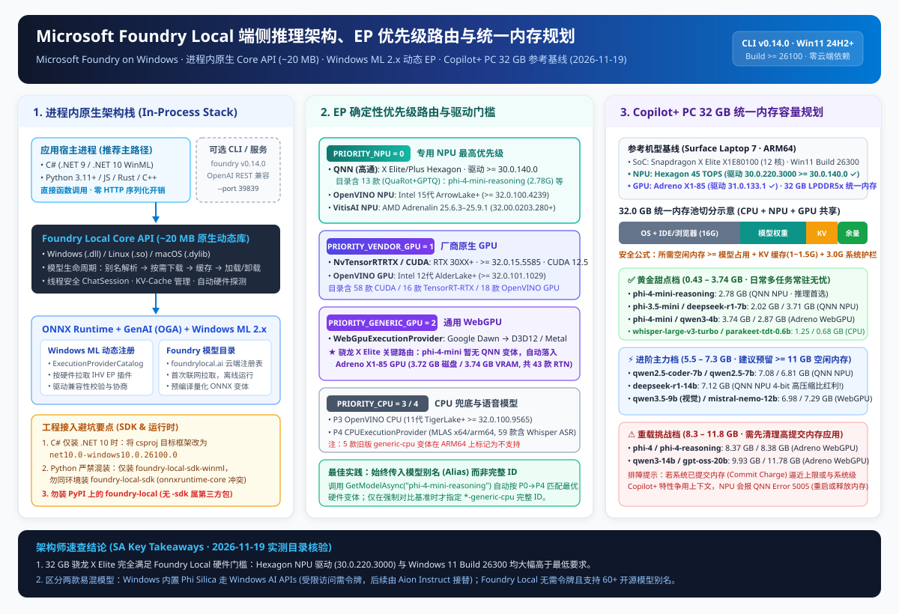
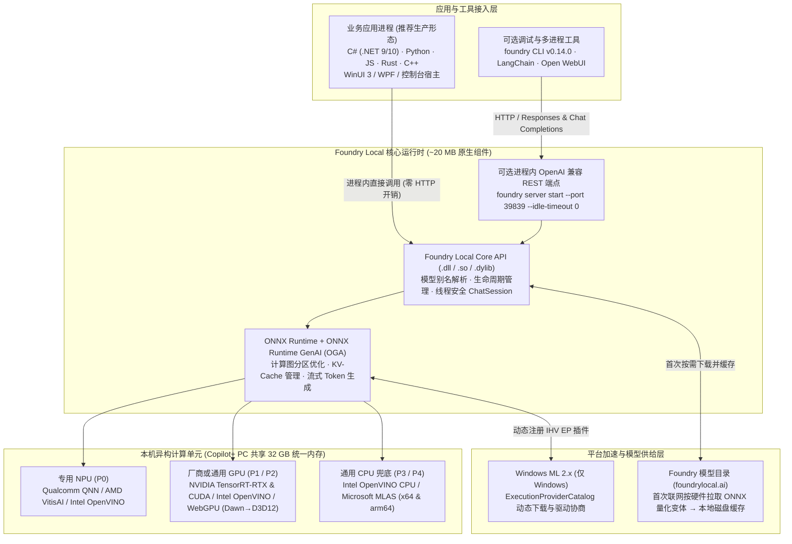
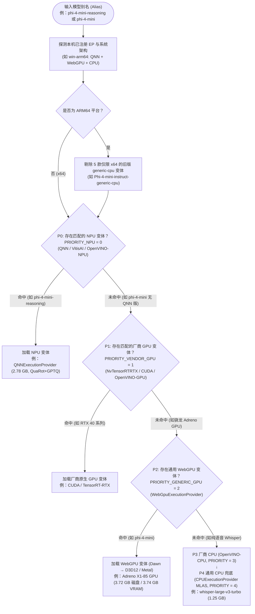

# Microsoft Foundry Local 端侧 AI 架构、硬件就绪度与选型决策指南

[English](foundry-local-on-device-ai-guide.en.md) | [仓库首页](README.md) | [交互式硬件与统一内存评估器](workshops/foundry-local/sizer.html) | [Claude Workshop 指南](claude-on-foundry-workshop-guide.md) | [既有 AOAI 配置手册](azure-foundry-aoai-guide.md)

> **核验基线与隐私说明（2026-11-19）：** 本文基于 Microsoft Learn 官方文档（Windows AI 与 Microsoft Foundry Local 专栏）及 `foundrylocal.ai/api/models` 实时模型目录快照综合整理。文中硬件就绪度分析采用通用标准化的 **Copilot+ PC 参考机型基线（Microsoft Surface Laptop 7th Edition · Snapdragon X Elite X1E80100 12 核 · Hexagon NPU 45 TOPS 驱动 `30.0.220.3000` · Adreno X1-85 GPU 驱动 `31.0.133.1` · 32 GB LPDDR5x 统一内存 · Windows 11 Build `26300` · .NET 10 ARM64 与 Python 3.12 ARM64）**，不包含任何个人账户、本机路径或私有运行态信息。所有磁盘体积、显存/统一内存占用、驱动版本号与目录计数均来自上述已核验数据，零估算杜撰。

## 导航

[1. 核心结论与参考机型就绪度](#executive-summary) · [2. 架构解剖与 EP 优先级路由图](#architecture) · [3. 核心架构与工程实战问答 (Q1–Q8)](#faq) · [4. 业务场景与模型选型决策矩阵](#decision-matrix) · [5. 投产前自检清单](#checklist) · [6. 参考来源与核验范围](#sources)

---

<a id="executive-summary"></a>
## 1. 核心结论与参考机型就绪度

针对最常见的问题——**“参考配置的 Windows 11 / Copilot+ PC 能否满足 Foundry Local 要求并流畅运行？”**——答案是：**完全满足，且在 32 GB 统一内存的骁龙 X Elite 机型上具备 NPU + GPU + CPU 全栈硬件加速能力**；但在工程落地时必须注意 **模型变体路由差异、统一内存提交压力（OS Commit Charge）以及 `.NET 10` / Python 包依赖隔离** 三大关键细节。

### 1.1 Copilot+ PC 参考机型就绪度记分卡

| 检查维度 | Foundry Local 官方最低门槛 | Copilot+ PC 参考机型基线 | 判定 | 关键工程提示 |
| --- | --- | --- | --- | --- |
| **操作系统版本** | Windows 11 24H2 (`Build 26100`) 及以上 | Windows 11 `Build 26300` (`win-arm64`) | **通过** | 支持 Windows ML `ExecutionProviderCatalog` 按需动态拉取硬件 EP |
| **高通 NPU 加速 (`QNN`)** | Snapdragon X Elite (`X1Exxxxx`) / X Plus (`X1Pxxxxx`)，Hexagon NPU 驱动 `>= 30.0.140.0` | Snapdragon X Elite `X1E80100` (12 核)，Hexagon 45 TOPS 驱动 `30.0.220.3000` | **通过** | 可原生运行全部 **13 款** `QNNExecutionProvider` (`QuaRot + GPTQ`) 模型 |
| **GPU 加速 (`WebGPU`)** | 支持 Direct3D 12 的物理 GPU 与最新驱动 | Qualcomm Adreno X1-85 GPU，驱动 `31.0.133.1` | **通过** | 通过 Google Dawn 转译至 D3D12，承接 **43 款** `WebGpuExecutionProvider` (`RTN`) 模型 |
| **内存与显存池** | 取决于所选模型体积 + KV 缓存余量 | **32 GB** Unified LPDDR5x 统一内存（CPU/NPU/GPU 共享） | **通过** | `0.43–3.74 GB` 模型可常驻并发；`7–10 GB` 级模型需确保系统空闲内存充足 |
| **.NET 开发环境** | `.NET 9.0+` SDK（WinML 快速入门默认写 `net9.0-windows10.0.26100.0`） | 仅安装 `.NET 10` ARM64 SDK/Runtime（无 `.NET 9` 运行时） | **需改配置** | 将 `.csproj` 的 `<TargetFramework>` 改为 `net10.0-windows10.0.26100.0` 即可直接编译运行 |
| **Python 开发环境** | Python `3.11+` + `foundry-local-sdk-winml` | Python `3.12` ARM64 | **通过** | 必须在独立 `venv` 中**仅安装** `foundry-local-sdk-winml`，严禁混装 `foundry-local-sdk` |
| **可选 CLI 与本地服务** | `Microsoft.FoundryLocal` `v0.14.0.0` + `Microsoft.VCLibs.Desktop.14 >= 14.0.33728.0` | 原生适配 `foundry-0.14.0-win-arm64.msix` | **通过** | 进程内 SDK 开发**不需要**安装 CLI；仅终端调试或暴露本地 OpenAI REST 端点时按需安装 |

### 1.2 四条核心架构洞察

1. **进程内原生库而非重型后台守护进程：** Foundry Local 的核心是嵌入应用进程内的原生 Core API 动态库（仅增加约 **`~20 MB`** 应用包体积），底层调用 ONNX Runtime、ONNX Runtime GenAI (OGA) 与 Windows ML。无需 Azure 订阅、无需 API Key、无需申請受限访问解锁令牌（LAF Unlock Token），首次下载模型与 EP 后即可 **100% 离线运行**。
2. **官方示例模型 `phi-4-mini` 在骁龙 X Elite 上的真实路由：** 截至 `2026-11-19` 实时目录，Microsoft Learn 快速入门示例使用的别名 `phi-4-mini`（Instruct 版）**暂无 `QNNExecutionProvider` 变体**，因此在骁龙 X Elite 上会自动路由至 Adreno X1-85 GPU 的 **`WebGpuExecutionProvider`**（磁盘 `3.72 GB` / 显存占用 `3.74 GB`）；而推理增强模型 **`phi-4-mini-reasoning`（`2.78 GB`）** 则具备原生 QNN 变体，直接跑在 Hexagon 45 TOPS NPU 上。
3. **32 GB 统一内存不等于 32 GB 可用模型容量：** Copilot+ PC 的 CPU、Hexagon NPU 与 Adreno GPU 共享同一块 32 GB LPDDR5x 物理内存并受 Windows 系统提交上限（Commit Limit）约束。当 IDE、浏览器与容器已提交 18–22 GB 内存时，强行加载 `8–10 GB` 模型会触发内存分配失败或 **QNN 错误码 `5005`**。可使用配套的 [交互式硬件就绪度与统一内存评估器](workshops/foundry-local/sizer.html) 实时测算当前空闲内存下的安全模型清单。
4. **分清 `Phi Silica` 与 `Foundry Local`：** Windows 内置的 `Phi Silica` 属于 **Windows AI APIs**，仍受限于受限访问特性（LAF，需申请解锁令牌，后续计划由免令牌的 `Aion Instruct` 接替）；**Foundry Local** 则面向任意 Windows 11 24H2+ 硬件（及 macOS Apple Silicon / Linux）提供 60+ 款开源模型别名与标准 OpenAI 兼容接口。



---

<a id="architecture"></a>
## 2. 架构解剖与 EP 优先级路由图

### 2.1 进程内原生运行时与可选本地服务架构



### 2.2 模型别名到硬件变体的确定性优先级决策流

当业务代码传入模型别名（如 `catalog.GetModelAsync("phi-4-mini-reasoning")` 或 `foundry chat phi-4-mini`）时，Foundry Local 按固定的五级硬件优先级（`0` 最高，`4` 兜底）结合当前平台架构过滤出排名第一的可用变体：



---

<a id="faq"></a>
## 3. 核心架构与工程实战问答 (Q1–Q8)

### Q1：Windows AI 相关名词频繁更迭，Windows AI APIs (Phi Silica)、Foundry Local、Windows ML 与云端 Microsoft Foundry 到底如何区分？

微软在 2024–2026 年间将端侧 AI 品牌统一收敛至 **Microsoft Foundry on Windows** 伞形体系下。架构师在方案选型时可按“**控制粒度 vs 开箱即用程度**”将其划分为四层：

| 方案层级 | 归属与当前正式名称 | 模型来源与硬件范围 | 准入令牌 / 费用 | 典型适用场景 |
| --- | --- | --- | --- | --- |
| **第 1 层：系统内置现成能力** | **Windows AI APIs**（旧称 Copilot Runtime APIs） | 微软随 Windows 分发管理的内置模型（如 **Phi Silica**、OCR、图像超分、语义搜索）；主要面向 **Copilot+ PC**（部分 API 支持特定独立 GPU） | 零云端费用；**注意：`Phi Silica` 目前仍为受限访问特性（LAF），需向微软申请解锁令牌；官方已规划后续由免令牌的 `Aion Instruct` 接替** | 希望零应用包体积膨胀、直接复用操作系统内置文本摘要/改写与系统视觉能力的轻量客户端功能 |
| **第 2 层：端侧多模型开箱推理** | **Foundry Local**（隶属 Microsoft Foundry on Windows） | 官方精选预量化目录（**60+ 模型别名 / 220+ 硬件变体**，含 Phi-4、Qwen2.5/3/3.5、DeepSeek-R1、Mistral、Whisper 等）；支持 **任意 Windows 11 24H2+ 设备** 及 macOS / Linux | **无需解锁令牌、无需 Azure 订阅**、零 Token 费用；仅首次下载模型与 EP 需联网 | 需要指定开源模型（代码、推理、多模态、ASR、Embedding）、跨硬件交付桌面应用、离线/数据不出端、或复用 OpenAI 兼容协议 |
| **第 3 层：自带模型底层引擎** | **Windows ML (2.x 新版)**（NuGet 分发，取代旧版 WinRT 内置 Windows ML） | **自带任意 ONNX 模型 (BYOM)**，开发者完全掌控预处理、分词、推理管线与 `ExecutionProviderCatalog` | 免费 SDK（需遵守各硬件厂商 EP 随附许可条款） | 自研行业专有视觉/风控/工业检测 ONNX 模型，或需要精细控制算子图编译与自定义前后处理管线 |
| **第 4 层：云端前沿大模型平台** | **Microsoft Foundry**（云端平台，与端侧同名但独立团队） | 云端托管前沿大模型（GPT-4o、Claude、MAI、大型推理与多代理编排服务） | 需 Azure 订阅，按 Token 或托管算力计费 | 超长上下文、复杂跨系统工具编排、多用户高并发服务，或作为端侧能力不可用时的云端回退层 |

**命名排雷速查：**
- **Windows Copilot Runtime (2024)** 与 **Windows AI Foundry (2025)** 均已退役，现统称 **Microsoft Foundry on Windows**（涵盖 Windows AI APIs + Foundry Local + Windows ML）。
- **DirectML** 在新版 Windows ML 2.x 中已归为传统（Legacy）GPU EP，**不是 NPU 执行路径**；当前跨厂商通用 GPU 路径正向基于 Google Dawn 的 `WebGpuExecutionProvider` 及厂商原生 EP 演进。

---

### Q2：Foundry Local 是类似 Ollama 的常驻后台 Web 服务吗？它的 `~20 MB` 运行时里包含什么？

**不是。** 官方架构文档明确指出：Foundry Local 首先是一套**随业务应用一起分发的端侧推理运行时与原生 SDK**，CLI 和本地 Web Server 只是面向开发调试或跨进程工具集成的可选附件。

1. **生产推荐路径（进程内 SDK 直连）：**
   - 宿主程序（C# WinUI 3 / WPF / 控制台、Python、Node.js、Rust、C++）直接加载 `Foundry Local Core API` 原生动态库（Windows 上为 `.dll`），仅给安装包增加约 **`~20 MB`** 体积。
   - 请求在宿主进程内存中直接调用 ONNX Runtime 与 OGA，**没有本地回环 HTTP 序列化开销、没有端口冲突、也不需要终端用户额外安装守护进程**。
2. **开发与生态集成路径（可选 CLI + 本地 OpenAI 兼容服务）：**
   - 当需要用命令行管理模型缓存，或让 LangChain、Open WebUI 等基于 HTTP 的外部工具连接本地模型时，可安装预览版 CLI `Microsoft.FoundryLocal`（当前核验版本 **`v0.14.0.0`**，安装包 `foundry-0.14.0-win-arm64.msix` / `win-x64.msix`，依赖 `Microsoft.VCLibs.Desktop.14 >= 14.0.33728.0`）。
   - 支持固定端口常驻启动：`foundry server start --port 39839 --idle-timeout 0`，对外暴露兼容 OpenAI Chat Completions 与 **OpenAI Responses API** 格式的本地端点。
3. **严格的客户端单用户边界：**
   - Foundry Local 针对**终端设备单用户交互**做了深度优化（模型按需加载卸载、单会话 KV-Cache 管理、硬件自动探测），**不提供**多用户并发请求队列、Continuous Batching（连续批处理）或多卡张量并行。
   - 若目标是机房服务器或边缘集群支撑多并发客户端，应选用 **vLLM / Triton Inference Server**，或在 Azure Arc 纳管的本地基础设施上评估 **Foundry Local on Azure Local**。

---

### Q3：Execution Provider (EP) 硬件矩阵与最低驱动版本门槛是什么？

在 Windows 11 24H2 (`Build 26100`)+ 上，`Microsoft.AI.Foundry.Local.WinML`（C#）与 `foundry-local-sdk-winml`（Python）借助 Windows ML 动态探测硬件并按需下载注册厂商 EP 插件（仅首次或 EP 升级时下载）。各 EP 的核验门槛如下：

| 优先级 | Execution Provider 名称 | 目标硬件范围 | 最低驱动与软件门槛（官方核验值） | 分发方式与注意事项 |
| --- | --- | --- | --- | --- |
| **`0` (最高)** | `QNNExecutionProvider` (高通) | Snapdragon X Elite (`X1Exxxxx`) / X Plus (`X1Pxxxxx`) Hexagon NPU | Qualcomm Hexagon NPU 驱动 **`>= 30.0.140.0`**（参考机型 `30.0.220.3000` 已达标） | WinML 按需动态下载；需遵守 Qualcomm Neural Processing SDK 许可 |
| **`0` (最高)** | `OpenVINOExecutionProvider` (Intel NPU) | Intel Core Ultra 15 代 (`ArrowLake`) 及更新款内置 NPU | Intel NPU 驱动 **`>= 32.0.100.4239`** | WinML 按需动态下载；需安装 Intel 官方 Windows NPU 驱动 |
| **`0` (最高)** | `VitisAIExecutionProvider` (AMD NPU) | AMD Ryzen AI 系列内置 NPU | Adrenalin **`25.6.3–25.9.1`**，NPU 驱动 **`32.00.0203.280–32.00.0203.297`** | WinML 按需动态下载；存在明确的驱动版本窗口约束 |
| **`1`** | `NvTensorRTRTXExecutionProvider` / `CUDAExecutionProvider` (NVIDIA) | NVIDIA GeForce **RTX 30XX** 及更新系列独立显卡 | Windows 显卡驱动 **`>= 32.0.15.5585`** + **CUDA `12.5`** | CUDA 内置 / TensorRT-RTX 动态下载；需遵守 NVIDIA SDK EULA |
| **`1`** | `OpenVINOExecutionProvider` (Intel GPU) | Intel 12 代 (`AlderLake`) 及更新款核显 / Arc GPU | Intel 显卡驱动 **`>= 32.0.101.1029`** | WinML 按需动态下载；遵守 Intel OBL 商业分发许可 |
| **`2`** | `WebGpuExecutionProvider` (跨厂商通用 GPU) | 任意支持 **Direct3D 12** 的 Windows GPU（含高通 Adreno、AMD Radeon、Intel、NVIDIA）及 macOS Apple Silicon | 最新版 D3D12 显卡驱动（参考机型 Adreno `31.0.133.1` 已达标） | Google Dawn 转译层（Windows: `WebGPU → Dawn → D3D12`；macOS: `WebGPU → Dawn → Metal`） |
| **`3`** | `OpenVINOExecutionProvider` (Intel CPU) | Intel 11 代 (`TigerLake`) 及更新款 x64 CPU | 系统驱动 **`>= 32.0.100.9565`** | WinML 按需动态下载 |
| **`4` (兜底)** | `CPUExecutionProvider` (通用 CPU) | 任意 `x64` 或 `arm64` 处理器 | 无特殊驱动门槛（内置 Microsoft **MLAS** 矩阵加速库） | 始终内置可用；无 NPU/GPU 变体的语音转录（Whisper 等）默认走此路径 |

> **附注：** Windows ML 2.x 还引入了面向 AMD 显卡的统一 `AMDGPUExecutionProvider`（需 Adrenalin `24.12.1+`），而旧版 `MIGraphXExecutionProvider` 已标记为弃用且当前不支持生成式 AI 场景。

---

### Q4：为什么在骁龙 X Elite (Copilot+ PC) 上运行 `phi-4-mini` 不会走 NPU，而 `phi-4-mini-reasoning` 会走 NPU？当前目录里各硬件通道有哪些代表模型？

这是在 Copilot+ PC 上实测 Foundry Local 最容易误判的现象：
- **原因在于云端目录是否存在该别名的预编译 QNN 变体。** 高通 Hexagon HTP NPU 需要针对特定算子图做离线 `QuaRot + GPTQ` 量化与上下文编译。截至 `2026-11-19` 的 `foundrylocal.ai/api/models` 实时快照，`phi-4-mini`（标准指令微调版）发布了 VitisAI NPU、OpenVINO NPU/GPU、CUDA、WebGPU 与 CPU 变体，但**尚未发布 `QNNExecutionProvider` 变体**。
- 当你在骁龙 X Elite 上请求别名 `phi-4-mini` 时，优先级解析器在 `P0 (QNN)` 与 `P1 (厂商专属 GPU)` 均未找到匹配项，于是自动顺延命中 `P2` 的 **`WebGpuExecutionProvider`**，在 Adreno X1-85 GPU 上加载运行（磁盘体积 **`3.72 GB`**，显存占用 **`3.74 GB`**）；同时其旧版 `Phi-4-mini-instruct-generic-cpu` 因标记了 `UNSUPPORTED_ON_ARM64` 被自动屏蔽，避免在 ARM64 CPU 上误载不兼容包。
- 相反，当你请求 **`phi-4-mini-reasoning`** 时，目录中存在预编译好的 QNN NPU 变体（**`2.78 GB`**，`QuaRot + GPTQ`），解析器直接命中 `P0 (QNNExecutionProvider)`，全部推理负载卸载至 Hexagon NPU，释放 CPU 与 GPU 资源。

#### 实时目录三大核心通道模型盘点（2026-11-19 快照）

1. **`QNNExecutionProvider` 原生高通 NPU 通道（共 13 款，全部采用 `QuaRot + GPTQ` 量化）：**
   - **轻量极速档 (`<= 2.1 GB`)：** `qwen2.5-0.5b` (`0.43 GB`)、`qwen2.5-coder-0.5b` (`0.43 GB`)、`qwen2.5-1.5b` (`1.06 GB`)、`qwen2.5-coder-1.5b` (`1.06 GB`)、`deepseek-r1-1.5b` (`1.52 GB`)、`phi-3.5-mini` (`2.02 GB`)。
   - **均衡推理档 (`2.7 – 3.8 GB`)：** `phi-4-mini-reasoning` (`2.78 GB`)、`phi-3-mini-4k` (`3.54 GB`)、`phi-3-mini-128k` (`3.54 GB`)、`deepseek-r1-7b` (`3.71 GB`)。
   - **大参数进阶档 (`6.8 – 7.2 GB`)：** `qwen2.5-7b` (`6.81 GB`)、`qwen2.5-coder-7b` (`7.08 GB`)、`deepseek-r1-14b` (`7.12 GB` —— 得益于 4-bit 量化，比 WebGPU 版的 `10.27 GB` 节省超过 3 GB 统一内存！)。

2. **`WebGpuExecutionProvider` 通用 GPU 通道（共 43 款，`RTN` 量化，骁龙 Adreno / 任意 DX12 GPU / Apple Silicon 均可加速）：**
   - **主力对话与推理：** `qwen3-0.6b` (`0.52 GB`)、`qwen3-1.7b` (`1.39 GB`)、`smollm3-3b` (`2.20 GB`)、`qwen3-4b` (`2.87 GB`)、`phi-4-mini` (`3.72 GB` 磁盘 / `3.74 GB` VRAM)、`deepseek-r1-8b` (`5.79 GB`)、`qwen3-8b` (`6.00 GB`)、`mistral-nemo-12b-instruct` (`7.29 GB`)、`phi-4` (`8.37 GB`)、`phi-4-reasoning` (`8.38 GB`)、`qwen3-14b` (`9.93 GB`)。
   - **多模态视觉理解 (Vision-Language)：** `qwen3.5-0.8b` (`1.45 GB`)、`qwen3.5-2b` (`2.97 GB`)、`ministral-3-3b-instruct-2512` (`3.59 GB`)、`qwen3.5-4b` (`4.09 GB`)、`gemma-4-e2b-it` (`6.87 GB`)、`qwen3.5-9b` (`6.98 GB`)。
   - **向量嵌入与路由决策 (Embeddings / Decision / Ranking)：** `qwen3-embedding-0.6b` (`0.50 GB`)、`qwen3-embedding-8b` (`6.00 GB`)、`kev-0.8b` (`1.21 GB`)、`kev-4b` (`5.54 GB`)、`clm-v0.1-8b` (`8.34 GB`)。

3. **`CPUExecutionProvider` 通用 CPU 通道（共 59 款，`RTN` 量化）：**
   - 除覆盖绝大多数文本模型兜底外，独占承载轻量离线语音识别（ASR）家族：`whisper-tiny` (`0.13 GB`)、`whisper-base` (`0.20 GB`)、`whisper-small` (`0.43 GB`)、`parakeet-tdt-0.6b-v2` (`0.68 GB`)、`nemotron-3.5-asr-streaming-0.6b` (`0.74 GB`)、`whisper-medium` (`0.92 GB`)、`whisper-large-v3-turbo` (`1.25 GB`)。（注：在配备 NVIDIA 独显的 x64 机器上，上述 ASR 模型亦提供更小的 CUDA GPU 变体。）
   - **ARM64 平台过滤提示：** 目录中 `Phi-4-mini-instruct-generic-cpu` 及 4 款 `deepseek-r1-distill-*-generic-cpu`（`1.5b/7b/8b/14b`）被标记为 `UNSUPPORTED_ON_ARM64`，在骁龙设备上仅走对应的 QNN 或 WebGPU 变体（或专门针对 CPU 优化的 `dq44` 变体）。

---

### Q5：既然参考机型拥有 32 GB 内存，为什么加载 8–10 GB 模型时仍可能遇到内存不足或崩溃？统一内存该如何科学核算？

在传统配备独立显卡（如 RTX 4080 16 GB VRAM + 32 GB 系统内存）的台式机上，模型权重常驻独立显存，与浏览器、IDE 的系统内存互不挤占。而在 **Copilot+ PC（Snapdragon X Elite / Intel Core Ultra / Apple Silicon）的统一内存架构（Unified Memory Architecture）** 下：

1. **同一物理池争用：** Windows 内核、桌面合成器、后台安全组件、IDE、数十个浏览器标签页、WSL2/容器，与 Hexagon NPU 的 `EpContext` 连续物理内存块或 Adreno GPU 的 Direct3D 12 共享显存，全部从同一块 **32 GB LPDDR5x** 中分配。
2. **Windows 已提交内存（Commit Charge）隐形红线：** 即使任务管理器显示还有“可用物理内存”，如果多进程虚拟内存提交总量（Committed）逼近 `物理内存 + 页面文件` 上限，或者物理内存碎片化导致无法分配连续的 NPU/D3D12 映射缓冲区，模型加载阶段就会直接抛错（例如 NPU 侧常见的 `Qnn error code 5005` 或 GPU 侧空输出/会话创建失败）。
3. **实用工程容量公式：**

$$\text{建议当前空闲内存 (Free RAM)} \ge \text{模型运行占用 (VRAM Footprint)} + \text{KV 缓存与激活开销 (1.0–1.5 GB)} + \text{系统提交安全护栏 (3.0 GB)}$$

| 机型统一内存规格 | 典型办公负载下空闲内存 | 无感常驻安全上限 | 重载峰值可运行上限（关闭大型 IDE/浏览器后） | 推荐主力模型组合 |
| --- | --- | --- | --- | --- |
| **16 GB Copilot+ PC** | 约 `4.5 – 6.5 GB` | 模型占用 `<= 2.2 GB` | 模型占用 `<= 3.8 GB` | `phi-3.5-mini` (`2.02 GB` NPU)、`qwen2.5-coder-1.5b` (`1.06 GB` NPU)、`phi-4-mini-reasoning` (`2.78 GB` NPU，轻负载下) |
| **32 GB Copilot+ PC（参考机型）** | 约 `11.0 – 16.0 GB` | 模型占用 `<= 7.1 GB` | 模型占用 `<= 10.0 GB` | 日常主力：`phi-4-mini-reasoning` (`2.78 GB` NPU) + `phi-4-mini` (`3.74 GB` GPU) + `deepseek-r1-14b` (`7.12 GB` NPU)；清理后台后可跑 `phi-4` (`8.37 GB`) 或 `qwen3-14b` (`9.93 GB`) |

> 💡 **在线测算：** 打开本仓库内置的 [交互式硬件就绪度与统一内存评估器 (`workshops/foundry-local/sizer.html`)](workshops/foundry-local/sizer.html)，拖动“当前可用空闲内存”滑块即可实时查看全部代表模型的准入状态与精确余量。

---

### Q6：C# (`.NET 10` + WinML)、Python (`3.12 ARM64`) 与 CLI (`v0.14.0`) 如何快速上手？有哪些高频踩坑点？

#### 路径 A：C# 进程内原生 SDK（适配仅装 `.NET 10` 的机器）

> **⚠️ `.NET 10` 目标框架（TFM）避坑：** Microsoft Learn 当前快速入门模板默认写成 `<TargetFramework>net9.0-windows10.0.26100.0</TargetFramework>`。在仅安装了 `.NET 10 SDK/Runtime` 而未安装 `.NET 9 Runtime` 的开发机（如参考机型）上直接 `dotnet run` 会报找不到 `.NET 9.0` 框架。只需将 TFM 改为 **`net10.0-windows10.0.26100.0`** 即可原生运行。

```bash
dotnet new console -n FoundryLocalDemo
cd FoundryLocalDemo
dotnet add package Microsoft.AI.Foundry.Local.WinML
```

编辑 `FoundryLocalDemo.csproj`：

```xml
<Project Sdk="Microsoft.NET.Sdk">
  <PropertyGroup>
    <OutputType>Exe</OutputType>
    <!-- 若本机为 .NET 10 环境，使用 net10.0-windows10.0.26100.0；若为 .NET 9 则用 net9.0-windows10.0.26100.0 -->
    <TargetFramework>net10.0-windows10.0.26100.0</TargetFramework>
    <Nullable>enable</Nullable>
    <ImplicitUsings>enable</ImplicitUsings>
    <RuntimeIdentifiers>win-x64;win-arm64</RuntimeIdentifiers>
  </PropertyGroup>
</Project>
```

编辑 `Program.cs`（包含 EP 自动发现注册、按别名拉取模型、流式输出与确定性资源释放）：

```csharp
using Microsoft.AI.Foundry.Local;
using Microsoft.Extensions.Logging.Abstractions;
using Betalgo.Ranul.OpenAI.ObjectModels.RequestModels;

await FoundryLocalManager.CreateAsync(
    new Configuration { AppName = "FoundryLocalDemo" },
    NullLogger.Instance);

var manager = FoundryLocalManager.Instance;
try
{
    // 1. 探测并按需注册当前硬件可用的 Windows ML Execution Providers
    var eps = manager.DiscoverEps();
    if (eps.Any(ep => !ep.IsRegistered))
    {
        await manager.DownloadAndRegisterEpsAsync((epName, pct) =>
            Console.Write($"\r注册硬件加速插件 {epName}: {pct,5:F1}%"));
        Console.WriteLine();
    }

    // 2. 传入模型别名：骁龙 X Elite 上 phi-4-mini-reasoning 自动命中 QNN NPU (2.78 GB)
    //    若改为 phi-4-mini，则自动命中 Adreno WebGPU (3.74 GB)
    const string alias = "phi-4-mini-reasoning";
    var catalog = await manager.GetCatalogAsync();
    var model = await catalog.GetModelAsync(alias)
        ?? throw new InvalidOperationException($"目录中未找到模型别名 '{alias}'，请检查网络连接。");

    if (!await model.IsCachedAsync())
    {
        await model.DownloadAsync(p => Console.Write($"\r下载 {alias}: {p,5:F1}%"));
        Console.WriteLine();
    }

    await model.LoadAsync();
    Console.WriteLine($"已加载模型变体: {model.Id}");

    // 3. 流式生成响应
    var chatClient = await model.GetChatClientAsync();
    chatClient.Settings.Temperature = 0.2f;
    chatClient.Settings.MaxTokens = 512;

    using var cts = new CancellationTokenSource();
    await foreach (var chunk in chatClient.CompleteChatStreamingAsync(
        new[]
        {
            new ChatMessage { Role = "system", Content = "你是一位严谨的云与端侧 AI 架构师。" },
            new ChatMessage { Role = "user", Content = "用三句话总结端侧 NPU 推理的核心优势。" }
        },
        cts.Token))
    {
        Console.Write(chunk.Choices?[0]?.Message?.Content);
    }
    Console.WriteLine();

    await model.UnloadAsync();
}
finally
{
    manager.Dispose();
}
```

#### 路径 B：Python `3.12 ARM64` 进程内 SDK（严格隔离虚拟环境）

> **⚠️ 两大 PyPI 包名陷阱（必读）：**
> 1. **切勿同时安装 `foundry-local-sdk` 与 `foundry-local-sdk-winml`**：两者锁定了不同构建版本的 `onnxruntime-core`，混装会立即触发 pip 依赖冲突报错。Windows 硬件加速场景只装 **`foundry-local-sdk-winml`**；macOS / Linux 才装 `foundry-local-sdk`。
> 2. **切勿安装 `foundry-local`（不带 `-sdk` 后缀）**：PyPI 上的 `foundry-local` 是与微软无关的第三方同名包。

```powershell
python -m venv .venv
.\.venv\Scripts\Activate.ps1
pip install foundry-local-sdk-winml
```

创建 `app.py`：

```python
from foundry_local_sdk import Configuration, FoundryLocalManager

FoundryLocalManager.initialize(Configuration(app_name="my-local-assistant"))
manager = FoundryLocalManager.instance

# 按需下载并注册缺失的 Windows ML EP（如 QNNExecutionProvider / WebGpuExecutionProvider）
missing_eps = [ep.name for ep in manager.discover_eps() if not ep.is_registered]
if missing_eps:
    manager.download_and_register_eps(missing_eps)

model = manager.catalog.get_model("phi-4-mini-reasoning")
if model is None:
    raise RuntimeError("未找到指定模型别名，请检查网络或目录。")

if not model.is_cached:
    model.download(lambda p: print(f"\r正在下载模型: {p:.1f}%", end="", flush=True))
    print()

model.load()
try:
    client = model.get_chat_client()
    for chunk in client.complete_streaming_chat(
        [{"role": "user", "content": "简述统一内存架构对端侧大模型容量规划的影响。"}]
    ):
        print(chunk.choices[0].delta.content or "", end="", flush=True)
    print()
finally:
    model.unload()
```

#### 路径 C：可选 CLI (`v0.14.0`) 与固定端口 OpenAI 兼容服务

```powershell
# 1. 当前用户安装（推荐，无需 --scope machine）
winget install Microsoft.FoundryLocal

# 重新打开终端后验证版本（核验基线为 0.14.0.0）
foundry --version

# 2. 查看当前设备匹配到的 NPU 或 GPU 模型列表（首次运行会自动下载对应 EP）
foundry model list --device npu
foundry model list --device gpu

# 3. 终端直接交互对话
foundry chat phi-4-mini-reasoning

# 4. 启动固定端口且不自动休眠的本地 OpenAI 兼容服务（供 LangChain / Open WebUI 调用）
foundry server start --port 39839 --idle-timeout 0
foundry server status
```

> **企业镜像批量部署提示：** 若管理员执行 `winget install Microsoft.FoundryLocal --scope machine` 报“当前系统配置不支持安装此程序包”（MSIX 机器级范围限制），请下载对应架构的 `foundry-0.14.0-win-arm64.msix`（或 `win-x64.msix`）及 `Microsoft.VCLibs.Desktop.14`（`>= 14.0.33728.0`）依赖包，在管理员 PowerShell 中执行：
> ```powershell
> Add-AppxProvisionedPackage -Online -PackagePath .\foundry-0.14.0-win-arm64.msix `
>   -DependencyPackagePath .\Microsoft.VCLibs.arm64.14.00.Desktop.appx -SkipLicense
> ```

---

### Q7：常见运行报错与良性警告如何快速定位排障？

| 现象 / 报错原文 | 严重级别 | 根因定位 | 标准处置方案 |
| --- | --- | --- | --- |
| `Qnn error code 5005: "Failed to load from EpContext model. qnn_backend_manager."` | **阻断错误** | 1. 高通 NPU 驱动低于 `30.0.140.0`；<br>2. 统一内存连续空间不足 / 提交内存触顶；<br>3. 系统级 Windows Copilot+ 特性（如工作室效果/回顾）正占用 HTP 上下文引发争用 | 1. 升级高通 NPU 驱动至最新（参考机型 `30.0.220.3000`）；<br>2. 关闭占用大量内存的浏览器/IDE 或停止 VS Code Foundry Toolkit 会话；<br>3. 重启系统清空 NPU 上下文锁 |
| `Request to local service failed. Uri: http://127.0.0.1:0/foundry/list` | **阻断错误** | CLI 后台守护进程尚未绑定有效端口或端口状态失效 | 执行 `foundry server restart`，随后通过 `foundry server status` 确认监听地址 |
| `foundry-local-sdk-winml requires onnxruntime-core==X.Y.Z, but you have ...` | **阻断错误** | 同一 Python 环境同时安装了 `foundry-local-sdk` 与 `foundry-local-sdk-winml` | 执行 `pip uninstall foundry-local-sdk foundry-local-sdk-winml`，随后在独立 `venv` 中仅安装其中一个 |
| 模型加载成功但返回空字符串 (`empty content`) | **运行异常** | 当前统一内存余量不足以完成长上下文分配，或指定了不兼容的变体 ID | 改传短别名（如 `qwen2.5-1.5b` / `phi-3.5-mini`），释放系统内存后重试 |
| `OGA Error: N instances of struct Generators::Model were leaked` | **良性警告** | 进程退出阶段底层 ONNX Runtime GenAI 原生对象计数跟踪日志打印顺序问题 | **无需修复**——推理结果完全有效，微软官方文档确认属已知无害退出提示 |
| `Error in cpuinfo: Unknown chip model name 'Snapdragon...'` | **良性警告** | ONNX Runtime 内置 `cpuinfo` 库未收录新款骁龙命名字符串，自动回退至安全默认 ARM64 特性集 | **无需修复**——NPU/GPU/CPU 推理均正常执行 |

---

### Q8：如何设计“系统内置 AI + Foundry Local + 云端 Microsoft Foundry”三级弹性回退架构？

在面向海量终端异构 PC 分发的商业桌面软件中，不应把所有赌注压在单一推理层上。Microsoft Learn 推荐采用**三级渐进式回退（Tiered Fallback）**模式：

1. **第一级（零体积、最低功耗）：Windows AI APIs (`Microsoft.Windows.AI.Text.LanguageModel`)**
   - 若用户设备为已获授权的 Copilot+ PC 且系统内置模型就绪（`AIFeatureReadyState.Ready`），优先调用系统级 API 处理轻量摘要、润色与分类，无需为你的应用单独下载数 GB 模型权重。
2. **第二级（跨硬件离线主力、模型可控）：Foundry Local (`Microsoft.AI.Foundry.Local.WinML`)**
   - 当设备非 Copilot+ PC、未申请 LAF 令牌、或业务需要特定能力（如 `qwen2.5-coder-7b` 本地代码生成、`qwen3.5-4b` 离线多模态看图、`whisper-large-v3-turbo` 本地会议录音转写、`qwen3-embedding-0.6b` 本地隐私知识库向量化）时，在取得用户首次下载确认后调用进程内 Foundry Local。
3. **第三级（复杂任务与算力兜底）：云端 Microsoft Foundry / Azure OpenAI**
   - 当终端剩余内存不足（例如 8 GB 老旧办公本）、需要超长上下文多文档综合推理、或涉及企业受控后端 MCP 工具编排时，平滑路由至云端 Foundry 部署端点（可结合本仓库 [Claude on Foundry Workshop 指南](claude-on-foundry-workshop-guide.md) 与 [既有 AOAI 配置手册](azure-foundry-aoai-guide.md) 实施）。

---

<a id="decision-matrix"></a>
## 4. 业务场景与模型选型决策矩阵

下表基于 **Copilot+ PC 32 GB 参考机型** 与 `2026-11-19` 实时目录数据编制，供架构师在方案设计阶段直接对照选用：

| 典型业务场景 | 推荐技术层与自动命中 EP | 推荐模型别名 (Alias) | 磁盘 / 运行占用 | 建议最低空闲内存 | 选型依据 |
| --- | --- | --- | --- | --- | --- |
| **本地结构化推理、逻辑校验与复杂指令拆解** | Foundry Local · `QNNExecutionProvider` (NPU) | `phi-4-mini-reasoning` | `2.78 GB` / `2.78 GB` | `>= 6.8 GB` | 原生跑在 Hexagon 45 TOPS NPU 上，能效比高，完全不占用 Adreno GPU 渲染资源 |
| **通用多轮中英文对话与本地文档问答** | Foundry Local · `WebGpuExecutionProvider` (GPU) 或 `QNN` (NPU) | `phi-4-mini` 或 `qwen3-4b`（GPU）<br>`deepseek-r1-7b`（NPU） | `3.74 GB` / `2.87 GB` (GPU)<br>`3.71 GB` (NPU) | `>= 7.5 – 8.0 GB` | `qwen3-4b` 中英文均衡；若希望后台持续运行且省电，优先选 NPU 原生的 `deepseek-r1-7b` 或 `phi-3.5-mini` (`2.02 GB`) |
| **离线代码补全、脚本生成与单测辅助** | Foundry Local · `QNNExecutionProvider` (NPU) | 轻量：`qwen2.5-coder-1.5b`<br>主力：`qwen2.5-coder-7b` | `1.06 GB` (1.5B)<br>`7.08 GB` (7B) | `>= 5.0 GB` (1.5B)<br>`>= 11.5 GB` (7B) | 两档尺寸均具备原生 QNN 变体；32 GB 机器日常可跑 7B，16 GB 机器稳选 1.5B |
| **端侧高阶数学/长链条深度思考（不出内网）** | Foundry Local · `QNNExecutionProvider` (NPU) | `deepseek-r1-14b` | `7.12 GB` / `7.12 GB` | `>= 11.5 GB` | QNN 4-bit (`QuaRot+GPTQ`) 将 14B 压缩至 `7.12 GB`（对比 WebGPU 版需 `10.27 GB`），是 32 GB 骁龙本的隐藏性价比冠军 |
| **离线截图解析、票据/表单视觉问答 (VLM)** | Foundry Local · `WebGpuExecutionProvider` (GPU) | 均衡：`qwen3.5-4b`<br>高精度：`qwen3.5-9b` | `4.09 GB` (4B)<br>`6.98 GB` (9B) | `>= 8.5 GB` (4B)<br>`>= 11.5 GB` (9B) | 当前多模态视觉模型通过 Dawn→D3D12 在 Adreno GPU 上硬件加速运行 |
| **敏感会议录音离线转写与实时字幕 (ASR)** | Foundry Local · `CPUExecutionProvider` (MLAS) | 高精度：`whisper-large-v3-turbo`<br>低延迟流式：`parakeet-tdt-0.6b-v2` / `nemotron-3.5-asr-streaming-0.6b` | `1.25 GB` (Whisper)<br>`0.68 / 0.74 GB` (流式) | `>= 5.0 GB` | 占用仅 0.7–1.3 GB，ARM64 MLAS CPU 即可实时转写，音频全程不离机 |
| **本地隐私文件检索 (RAG Embedding & 重排/路由)** | Foundry Local · `WebGpuExecutionProvider` (GPU) | 向量：`qwen3-embedding-0.6b`<br>路由决策：`kev-0.8b` | `0.50 GB` (Embedding)<br>`1.21 GB` (Decision) | `>= 5.0 GB` | 两者合计不到 `1.8 GB`，可与 `2.78 GB` 的 NPU 主对话模型同时驻留 32 GB 内存 |
| **跨系统企业数据库写入、超长上下文多代理协同** | **云端 Microsoft Foundry** (Responses / Agent Service) | 云端 GPT-4o / Claude 等部署 | 本地 `0 GB` | 无本地模型内存要求 | 超出单机算力与上下文边界，应走云端托管治理与受控 MCP 授权体系 |

---

<a id="checklist"></a>
## 5. 投产前自检清单 (Pre-flight Checklist)

在将 Foundry Local 集成进桌面客户端或在本机开展基准测试前，请逐项核对：

- [ ] **1. 系统版本核验：** 运行 `winver` 确认系统为 Windows 11 24H2（`Build >= 26100`；参考机型 `Build 26300` 已满足）。
- [ ] **2. 加速器驱动核验：** 在设备管理器中确认 NPU / GPU 驱动达到最低门槛（高通 Hexagon NPU `>= 30.0.140.0`；NVIDIA RTX `>= 32.0.15.5585` + CUDA `12.5`；Intel OpenVINO NPU `>= 32.0.100.4239` / GPU `>= 32.0.101.1029`；AMD VitisAI Adrenalin `25.6.3–25.9.1`）。
- [ ] **3. `.NET` 目标框架对齐：** 若本机仅装 `.NET 10` SDK，已将 `.csproj` 中的 `<TargetFramework>` 显式设为 `net10.0-windows10.0.26100.0` 并配置 `<RuntimeIdentifiers>win-x64;win-arm64</RuntimeIdentifiers>`。
- [ ] **4. Python 环境纯净性：** 已创建独立虚拟环境（`venv`），Windows 下仅安装 `foundry-local-sdk-winml`，未混装 `foundry-local-sdk`，也未误装第三方包 `foundry-local`。
- [ ] **5. 传入别名而非硬编码变体 ID：** 业务代码统一传入短别名（如 `phi-4-mini-reasoning`），交由运行时按 `P0 → P4` 自动选择目标客户机最优硬件变体。
- [ ] **6. 统一内存与提交上限检查：** 加载 `>= 6 GB` 模型前，检查任务管理器“性能 → 内存”中的**可用内存**与**已提交（Committed）**比例，预留至少 `模型体积 + 4 GB`（KV 缓存 + OS 护栏），并关闭冲突的本地推理调试插件（如 VS Code Foundry Toolkit 活跃会话）。
- [ ] **7. 首次下载交互体验设计：** 桌面 GUI 应用（WinUI 3 / WPF）在调用 `DownloadAsync` 与 `DownloadAndRegisterEpsAsync` 前已向用户展示明确的体积提示、进度条与取消按钮（`CancellationToken`）。
- [ ] **8. 生命周期与显存归还：** 会话结束后按序调用 `model.UnloadAsync()` 与 `manager.Dispose()`，避免后台空闲时长期锁死数 GB 统一内存。
- [ ] **9. 缓存盘加密与企业安全合规：** 若本地缓存目录（可通过 `foundry cache location` 查看，`foundry cache cd <path>` 迁移）存放业务微调模型或处理敏感数据，已确保所在磁盘启用 BitLocker 全盘加密。
- [ ] **10. 模型开源许可证审查：** 分发或商用前，已通过 `foundry model list --verbose` 或目录页逐一核对所选模型（MIT、Apache-2.0、Mistral、DeepSeek、Phi 等）及随附硬件 EP 的商业分发条款。

---

<a id="sources"></a>
## 6. 参考来源与核验范围

1. **Microsoft Learn — 开始使用 Foundry Local (Windows AI 专栏)：** [中文版](https://learn.microsoft.com/zh-cn/windows/ai/foundry-local/get-started) / [English](https://learn.microsoft.com/en-us/windows/ai/foundry-local/get-started)（核验 Windows 11 Build 26100 门槛、`Microsoft.AI.Foundry.Local.WinML`、`foundry-local-sdk-winml` 冲突说明、Phi Silica 与 Phi-4 Mini 边界及常见排障条目）。
2. **Microsoft Learn — 选择你的 Windows AI 解决方案：** [Choose your Windows AI solution](https://learn.microsoft.com/en-us/windows/ai/windows-ai-comparison)（核验 `Microsoft Foundry on Windows` 术语演进表及 Windows AI APIs → Foundry Local → Azure AI 三级回退代码模式）。
3. **Microsoft Learn — Foundry Local 产品概览与架构解析：** [What is Foundry Local?](https://learn.microsoft.com/en-us/azure/foundry-local/what-is-foundry-local) · [Foundry Local architecture overview](https://learn.microsoft.com/en-us/azure/foundry-local/concepts/foundry-local-architecture)（核验 `~20 MB` 原生 Core API、ONNX Runtime、Google Dawn → Direct3D 12 / Metal 转译链路、WinML 注册与单用户客户端定位）。
4. **Microsoft Learn — CLI 参考、最佳实践与 Windows ML EP 列表：** [Foundry Local CLI Reference](https://learn.microsoft.com/en-us/azure/foundry-local/reference/reference-cli) · [Best practices and troubleshooting](https://learn.microsoft.com/en-us/azure/foundry-local/reference/reference-best-practice) · [Windows ML execution providers](https://learn.microsoft.com/en-us/windows/ai/new-windows-ml/supported-execution-providers)（核验各厂商 EP 最低驱动版本、固定端口服务命令、QNN Error `5005` 与 `Add-AppxProvisionedPackage` 部署方案）。
5. **Foundry Local 实时模型目录与发行资产（核验日期 `2026-11-19`）：** [foundrylocal.ai/models](https://www.foundrylocal.ai/models) 及 `/api/models` 元数据快照（核验 CLI `v0.14.0` 发行包、五级 EP 优先级常量、`UNSUPPORTED_ON_ARM64` 列表，以及 QNN 13 款 / WebGPU 43 款 / CPU 59 款模型的精确磁盘与显存体积）。
