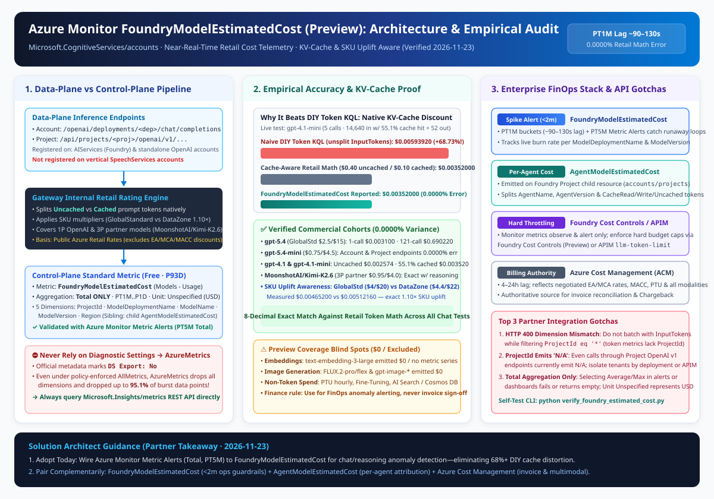
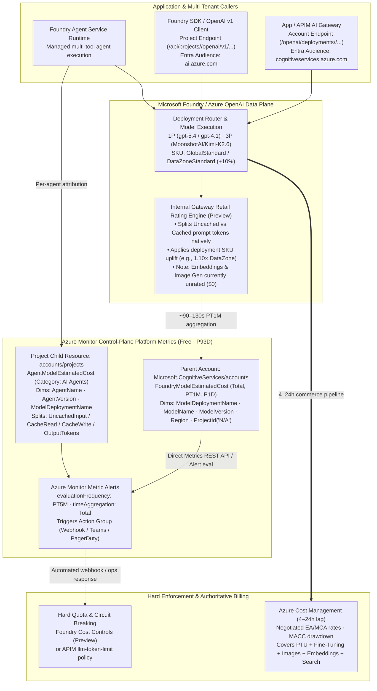

# Azure Monitor `FoundryModelEstimatedCost` (Preview): Architecture, Empirical Accuracy & Partner Decision Guide

[中文](foundry-model-estimated-cost-guide.md) | [Repository home](README.en.md) | [Interactive FinOps & Cache Variance Simulator](workshops/foundry-estimated-cost/calculator.en.html) | [Partner Self-Verification CLI](workshops/foundry-estimated-cost/verify_foundry_estimated_cost.py) | [Foundry Local guide](foundry-local-on-device-ai-guide.en.md) | [Existing AOAI manual (Chinese)](azure-foundry-aoai-guide.md)

> **Verification baseline & sanitization notice (2026-11-23):** Synthesized from official Microsoft Learn documentation and live control-plane/data-plane verification across four Azure regions (`eastus2`, `swedencentral`, `southeastasia`, `southindia`) on both `AIServices` (Microsoft Foundry) and standalone `OpenAI` accounts. Every empirical data point is strictly sanitized to public commercial model SKUs, published Azure retail rates, and 8-decimal-place measured figures—containing zero subscription GUIDs, tenant IDs, internal resource names, or non-public model codenames.

## Navigation

[1. Executive summary & partner readiness](#executive-summary) · [2. Control-plane vs data-plane telemetry architecture](#architecture) · [3. Empirical verification matrix (2026-11-23)](#empirical-matrix) · [4. Six partner pitfalls & workarounds](#pitfalls) · [5. Enterprise FinOps capability comparison](#comparison) · [6. Partner scenario decision matrix & ARM alert template](#decision-matrix) · [7. Partner pre-flight checklist](#checklist) · [8. Official Microsoft Learn references](#sources)

---

<a id="executive-summary"></a>
## 1. Executive summary & partner readiness

When partners ask **"How mature is `FoundryModelEstimatedCost`, how accurate is the math, and can we rely on it for customer FinOps dashboards or billing?"**, AI Solution Architects can answer with four verified engineering conclusions:

1. **Availability (Live out-of-the-box, zero setup):** `FoundryModelEstimatedCost` is a **free standard Azure Monitor platform metric** (`Advanced: No`, `P93D` 93-day retention) under namespace `Microsoft.CognitiveServices/accounts` (category `Models - Usage`). It is registered by default on both **`AIServices` (Foundry)** and standalone **`OpenAI`** accounts across tested commercial regions (not registered on vertical speech-only `SpeechServices` accounts). End-to-end `PT1M` ingestion latency measured **`~90–130 seconds` (`< 2 minutes`)**—orders of magnitude faster than Azure Cost Management's `4–24 hour` billing pipeline lag.
2. **Standout Technical Advantage (Native Prompt KV-Cache & SKU Uplift Awareness):** Naive DIY KQL formulas (`InputTokens × input_rate + OutputTokens × output_rate`) systematically overestimate spend whenever Prompt Caching is active because the account-level `InputTokens` metric **does not split cached vs uncached tokens**. In our live 5-call `gpt-4.1-mini` test at a `55.1%` cache hit rate, naive DIY token math overestimated actual retail cost by **`+68.73%`**, whereas `FoundryModelEstimatedCost` matched cache-aware retail pricing with **`0.0000%` error** (`$0.00352000` vs `$0.00352000`). Across 1P OpenAI models, 3P Foundry partner models (`MoonshotAI/Kimi-K2.6` including reasoning tokens), and `DataZoneStandard` `+10%` (`1.10×`) SKU uplifts, `FoundryModelEstimatedCost` matched retail token math to **8 decimal places (`0.0000%` variance)**.
3. **Three Hard Preview Boundaries (Never Substitute for Invoice Reconciliation):**
   - **Modality Blind Spots:** Live calls to **Embeddings (`text-embedding-3-large`)** and **Image Generation (`FLUX.2-pro`, `FLUX.2-flex`, `gpt-image-*`)** emitted **`$0` / no metric series**. It also excludes Provisioned Throughput Unit (PTU) hourly reservations, Fine-Tuning training/hosting hours, and downstream Azure AI Search or Cosmos DB charges.
   - **Public Retail Pricing Only:** Computed strictly from public Pay-As-You-Go retail rates; it has no visibility into negotiated Enterprise Agreement (EA), MCA custom rate cards, or MACC drawdowns.
   - **`ProjectId` Dimension Currently Emits `'N/A'`:** Although `ProjectId` is declared in the schema, stateless inference calls—even via Foundry Project OpenAI v1 endpoints (`/api/projects/<project>/openai/v1/chat/completions` with `https://ai.azure.com` Entra tokens)—currently emit `ProjectId = 'N/A'`. For per-agent attribution under Foundry Agent Service, query the sibling metric **`AgentModelEstimatedCost`** on the Foundry Project child resource (`Microsoft.CognitiveServices/accounts/projects`).
4. **Recommended Architectural Role:** **Deploy immediately for sub-5-minute operational burn-rate visibility and runaway-loop anomaly alerting (`Microsoft.Insights/metricAlerts`)**, paired with **Foundry Cost Controls / APIM AI Gateway** for hard request throttling and **Azure Cost Management** for authoritative monthly billing and multimodal coverage.

### 1.1 Verified `Microsoft.Insights/metricDefinitions` specification

| Specification field | Live control-plane value (`api-version=2024-02-01`) | Engineering implication |
| --- | --- | --- |
| **Resource namespace** | `Microsoft.CognitiveServices/accounts` | Registered on `kind: AIServices` and `kind: OpenAI`; **absent** on `kind: SpeechServices` |
| **Metric & display name** | `FoundryModelEstimatedCost` / `Foundry Model Estimated Cost (Preview)` | Listed under metric category `Models - Usage` |
| **Pricing tier & retention** | Standard platform metric (`Advanced: No` · **Free**) · `P93D` (93 days) | Queryable over a 93-day window at zero Azure Monitor ingestion cost |
| **Unit & aggregation** | `Unit: Unspecified` (represents **USD**) · **`Total` ONLY** | `Average`, `Min`, `Max`, and `Count` are unsupported; alerts and dashboards must specify `Total` |
| **Supported `timeGrain`s** | `PT1M`, `PT5M`, `PT15M`, `PT30M`, `PT1H`, `PT6H`, `PT12H`, `P1D` | Live probes appeared in `PT1M` buckets within **`~90–130 seconds`** of HTTP 200 completion |
| **Supported `dimensions`** | `ProjectId`, `ModelDeploymentName`, `ModelName`, `ModelVersion`, `Region` | Slice production dashboards by `ModelDeploymentName` and `ModelName`; `ProjectId` currently emits `'N/A'` |
| **Diagnostic Settings (`DS Export`)** | **`No` (Unsupported in `AzureMetrics` table)** | Policy-forced `AllMetrics` exports strip all 5 dimensions and dropped up to **`95.1%`** of burst points in testing |



---

<a id="architecture"></a>
## 2. Control-plane vs data-plane telemetry architecture

### 2.1 End-to-end rating, telemetry, alerting, and billing boundary diagram



---

<a id="empirical-matrix"></a>
## 3. Empirical verification matrix (2026-11-23)

We executed controlled single-request probes, 121-request concurrent batches, Foundry Project OpenAI v1 calls, 55.1% prompt-cache workloads, third-party partner reasoning calls, SKU-uplift A/B comparisons, and multimodal negative tests across live `AIServices` and `OpenAI` accounts.

### 3.1 Sanitized commercial model & modality scorecard

| Test cohort & model version | Deployment SKU & public retail rate (USD / 1M tokens) | Measured workload & token breakdown | Expected retail formula (USD) | Reported `FoundryModelEstimatedCost` | Relative error & key engineering finding |
| --- | --- | --- | --- | --- | --- |
| **1. `gpt-5.4` uncached single probe**<br>(`2026-03-05`) | `GlobalStandard`<br>`$2.50` in · `$15.00` out | `1` request<br>`940` in + `50` out | `$0.00310000` | **`$0.00310000`** | **`0.0000%` error**; ingested into `PT1M` bucket in `~105s` |
| **2. `gpt-5.4` multi-call batch**<br>(`2026-03-05`) | `GlobalStandard`<br>`$2.50` in · `$15.00` out | `121` requests<br>`214,204` in + `10,314` out | `$0.69022000` | **`$0.69022000`** | **`0.0000%` error**; zero dropped points via Metrics REST API (`Total`) |
| **3A. `gpt-5.4-mini` Account endpoint**<br>(`2026-03-17` · Account URL) | `GlobalStandard`<br>`$0.75` in · `$4.50` out | `1` request<br>`941` in + `60` out | `$0.00097575` | **`$0.00097575`** | **`0.0000%` error**; preserves full sub-cent 8-decimal precision |
| **3B. `gpt-5.4-mini` Project endpoint**<br>(`2026-03-17` · `/api/projects/<p>/openai/v1`) | `GlobalStandard`<br>`$0.75` in · `$4.50` out | `1` request (`https://ai.azure.com` audience)<br>`938` in + `50` out | `$0.00092850` | **`$0.00092850`** | **`0.0000%` error**; **however `ProjectId` still reported `'N/A'`** |
| **4. `gpt-4.1` uncached probe**<br>(`2025-04-14`) | `GlobalStandard`<br>`$2.00` in · `$8.00` out | `1` request<br>`1,087` in + `50` out | `$0.00257400` | **`$0.00257400`** | **`0.0000%` error** |
| **5. `gpt-4.1-mini` Prompt Cache Hit**<br>(`2025-04-14` · **55.1% Cache Hit**) | `GlobalStandard`<br>`$0.40` uncached in · **`$0.10` cached in** · `$1.60` out | `5` calls: `InputTokens = 14,640` (`6,576` uncached + `8,064` cached) + `52` out | Cache-aware retail: **`$0.00352000`**<br>*(Naive DIY KQL: `$0.00593920`)* | **`$0.00352000`** | **`0.0000%` error!** Proves native 75% KV-cache discount awareness vs **`+68.73%`** naive DIY overestimate |
| **6. `MoonshotAI/Kimi-K2.6` (3P partner)**<br>(`2026-04-20` · Foundry Partner) | `GlobalStandard`<br>`$0.95` in · `$4.00` out | `1` request<br>`797` in + `60` out (incl. `60` reasoning tokens) | `$0.00099715` | **`$0.00099715`** | **`0.0000%` error**; covers 3P Foundry catalog models and reasoning tokens accurately |
| **7A. SKU baseline (`GlobalStandard`)**<br>(identical model version in `eastus2`) | `GlobalStandard`<br>`$4.00` in · `$20.00` out | `1` request<br>`938` in + `45` out | `$0.00465200` | **`$0.00465200`** | **`0.0000%` error**; baseline for SKU uplift comparison |
| **7B. SKU uplift (`DataZoneStandard`)**<br>(identical model version in `eastus2`) | `DataZoneStandard` (**`+10%`**)<br>`$4.40` in · `$22.00` out | `1` request<br>`939` in + `45` out | `$0.00512160` | **`$0.00512160`** | **`0.0000%` error**; automatically applies exact **`1.10×`** DataZone SKU multiplier |
| **8. Embeddings (`text-embedding-3-large`)** | Token-metered embeddings | `2` calls · `InputTokens = 994` | `> $0` | **`$0` / no series** | **Preview blind spot:** `InputTokens` increments normally, but no cost series is emitted |
| **9. Image Generation (`FLUX.2-pro` / `FLUX.2-flex` / `gpt-image-*`)** | Per-image / image-token metered | `307` requests / `39` images over 30d | `> $0` | **`$0` / no series** | **Preview blind spot:** Track image spend in Azure Cost Management |

### 3.2 Why KV-cache awareness eliminates a major FinOps blind spot

Prior to `FoundryModelEstimatedCost`, operational teams typically estimated live spend from Azure Monitor token metrics using:

$$\text{Naive DIY Cost} = \frac{\text{InputTokens} \times P_{\text{in}} + \text{OutputTokens} \times P_{\text{out}}}{1,000,000}$$

**Why that breaks in production:** Account-level `InputTokens` reports total prompt tokens (`uncached + cached`) with **no dimension or companion account metric to separate `cached_tokens`**. Modern agentic loops, RAG system prompts, and coding assistants routinely achieve `50%–85%` prompt cache hit rates—where cached tokens bill at a `75%` to `90%` discount.

In Cohort #5 (`gpt-4.1-mini` at `55.1%` cache hit):
- **Naive DIY Token Formula:** $(14,640 \times 0.40 + 52 \times 1.60) / 10^6 = \$0.00593920$ (**`+68.73%` false inflation**—rising past **`+140%`** at an `80%` cache hit rate and triggering false-positive budget alarms).
- **Cache-Aware Retail Formula:** $(6,576 \times 0.40 + 8,064 \times 0.10 + 52 \times 1.60) / 10^6 = \$0.00352000$.
- **Measured `FoundryModelEstimatedCost`:** **`$0.00352000`** (`0.0000%` variance). Open the companion [Interactive FinOps & Cache Variance Simulator](workshops/foundry-estimated-cost/calculator.en.html) to model your own workload's cache hit rate, SKU tier, and negotiated EA/MCA discount gap.

---

<a id="pitfalls"></a>
## 4. Six partner pitfalls & workarounds

Avoid these six empirically verified integration traps when wiring `FoundryModelEstimatedCost` into customer dashboards, alerting pipelines, or FinOps scripts:

### Pitfall 1: Batching `FoundryModelEstimatedCost` with `InputTokens` and `$filter=ProjectId eq '*'` returns `HTTP 400 BadRequest`
- **Symptom:** Sending a single REST call with `metricnames=FoundryModelEstimatedCost,InputTokens,OutputTokens` and `$filter=ProjectId eq '*' and ModelDeploymentName eq '*'` fails immediately with `HTTP 400 BadRequest`.
- **Root cause:** `FoundryModelEstimatedCost` exposes `ProjectId`, whereas `InputTokens`, `OutputTokens`, and `ModelRequests` **do not have a `ProjectId` dimension**. Azure Monitor rejects multi-metric queries when a dimension filter does not exist on every requested metric.
- **Workaround:** Issue **two separate `Microsoft.Insights/metrics` queries** (one for `FoundryModelEstimatedCost` with `ProjectId eq '*'`, and a second for `ModelRequests,InputTokens,OutputTokens`), as implemented in [`verify_foundry_estimated_cost.py`](workshops/foundry-estimated-cost/verify_foundry_estimated_cost.py).

### Pitfall 2: Relying on `ProjectId` for multi-project chargeback on stateless OpenAI endpoints
- **Symptom:** Even when applications authenticate with `https://ai.azure.com` tokens and call a Foundry Project's dedicated endpoint (`/api/projects/<project>/openai/v1/chat/completions`), the returned timeseries metadata currently reports **`ProjectId = 'N/A'`**.
- **Root cause:** In Preview, stateless chat completion calls do not yet populate the parent account's `ProjectId` metric dimension.
- **Workaround:**
  1. **For Foundry Agent Service workloads:** Query **`AgentModelEstimatedCost`** on the Foundry Project child resource (`Microsoft.CognitiveServices/accounts/projects`), which slices cleanly by `AgentName` and `AgentVersion`.
  2. **For direct stateless model inference:** Isolate business units via dedicated `ModelDeploymentName`s, enforce per-tenant headers/subscriptions through **Azure API Management (APIM) AI Gateway**, and follow Microsoft Learn's [View costs for a Foundry project](https://learn.microsoft.com/en-us/azure/foundry/how-to/view-project-costs) tagging/resource architecture.

### Pitfall 3: Querying `FoundryModelEstimatedCost` from Log Analytics `AzureMetrics` via Diagnostic Settings
- **Symptom:** Organizations with Azure Policy-enforced `AllMetrics` Diagnostic Settings query `AzureMetrics | where MetricName == "FoundryModelEstimatedCost"` in Log Analytics and find **zero deployment/model dimensions and wildly undercounted totals**.
- **Root cause:** Official metric metadata explicitly marks **`DS Export: No`**. In our burst verification, `AzureMetrics` dropped all five dimensions (`ModelDeploymentName`, `ModelName`, `ModelVersion`, `ProjectId`, `Region`) and dropped up to **`95.1%`** of high-concurrency data points.
- **Workaround:** **Never aggregate `FoundryModelEstimatedCost` from `AzureMetrics`.** Always query the `Microsoft.Insights/metrics` REST API (or Azure Monitor Metrics Explorer / Managed Grafana's Azure Monitor Metrics data source) directly, and evaluate alerts natively via `Microsoft.Insights/metricAlerts`.

### Pitfall 4: Selecting `Average` or `Max` aggregation, or misinterpreting `Unit: Unspecified`
- **Symptom:** Dashboards or IaC templates defaulting to `Average` fail validation or render blank charts, and raw JSON payloads list `"unit": "Unspecified"`.
- **Workaround:** `FoundryModelEstimatedCost` supports **`Total` aggregation ONLY** (`supportedAggregationTypes: ["Total"]`), and its numeric value is **USD at public retail rates**. Hardcode `"timeAggregation": "Total"` in every alert criterion and chart panel.

### Pitfall 5: Guarding image-heavy or embedding-heavy accounts solely with `FoundryModelEstimatedCost`
- **Symptom:** Heavy `FLUX.2-pro` / `gpt-image-*` generation or `text-embedding-3-large` backfills consume real Azure budget while `FoundryModelEstimatedCost` remains at `$0.00`.
- **Workaround:** Pair `FoundryModelEstimatedCost` chat/reasoning alerts with `ModelRequests` / `InputTokens` rate alerts on embedding/image deployments, backed by **Azure Cost Management Budgets** at the resource/resource-group scope.

### Pitfall 6: Treating `FoundryModelEstimatedCost` totals as invoice-ready customer billing
- **Symptom:** A partner sums 30-day `FoundryModelEstimatedCost` values for a customer invoice and encounters discrepancies against the customer's EA/MCA discount, MACC drawdown, or PTU reservation bill.
- **Workaround:** Label dashboards explicitly as **"Estimated PAYG Retail Run-Rate (USD, Preview)"** for operational anomaly detection and deployment-level optimization; use **Azure Cost Management** exclusively for financial chargeback and invoicing.

---

<a id="comparison"></a>
## 5. Enterprise FinOps capability comparison

No single telemetry stream provides sub-2-minute latency, hard request blocking, negotiated enterprise discounts, and full multi-service coverage simultaneously. Combine these five surfaces intentionally:

| Dimension | `FoundryModelEstimatedCost` (Preview · Parent Account) | `AgentModelEstimatedCost` (Project Child Resource) | Foundry Cost Controls (Preview) / APIM AI Gateway | Azure Cost Management (ACM) | Naive DIY Token KQL (`InputTokens × rate`) |
| --- | --- | --- | --- | --- | --- |
| **Resource scope** | `Microsoft.CognitiveServices/accounts` (`Models - Usage`) | `Microsoft.CognitiveServices/accounts/projects` (`AI Agents`) | Foundry portal cost controls / APIM `llm-token-limit` | Subscription / Resource Group / Resource / Tags | Custom KQL or script over token metrics |
| **Visibility latency** | **Near-real-time `~90–130s`** (`PT1M`) | **Near-real-time minutes** (`PT1M`) | **Inline / near-real-time enforcement** | Slow (**`4–24 hours`** commerce lag) | Near-real-time (`1–5 min`) |
| **Prompt KV-cache discount** | **✅ Native exact match** (`0.0000%` error) | **✅ Native** (plus explicit `CacheRead` / `CacheWrite` / `Uncached` token metrics) | Policy-dependent (APIM typically limits raw tokens) | **✅ Exact billed usage** | **❌ Blind to cache hits** (`+68.73%+` overestimate) |
| **SKU uplift & 3P models** | **✅ Automatic** (`DataZoneStandard` `1.10×`, Kimi-K2.6, etc.) | **✅ Automatic** across agent-bound deployments | Enforced per route or deployment | **✅ Complete** across all billed meters | ❌ Fragile manual price-table maintenance |
| **Modality & PTU coverage** | Supported PAYG chat/reasoning models only (**$0 for Embeddings, Images, PTU, Fine-Tuning**) | Models invoked through **Foundry Agent Service** | Covered gateway/project endpoints | **✅ 100% coverage** (Images, Embeddings, PTU, Fine-Tuning, AI Search, Cosmos DB) | Text token endpoints only |
| **EA / MCA / MACC discounts** | ❌ Excluded (public retail rates) | ❌ Excluded (public retail rates) | ❌ Excluded | **✅ Authoritative** negotiated rates, taxes & MACC | ❌ Excluded unless hardcoded manually |
| **Hard traffic cutoff** | Observe & alert only (pair with Action Group webhooks) | Observe & alert only | **✅ Hard cutoff** (`HTTP 429` budget/rate protection) | Notification / webhook budgets | Post-hoc query only |

---

<a id="decision-matrix"></a>
## 6. Partner scenario decision matrix & ARM alert template

### 6.1 Partner workload & FinOps decision matrix

| Partner / customer requirement | Recommended primary mechanism | Architectural implementation pattern |
| --- | --- | --- |
| **"Catch runaway agent loops or leaked dev keys within 5 minutes before thousands of dollars burn"** | **`FoundryModelEstimatedCost` + Azure Monitor Metric Alert (`PT5M`)** | Alert on `Total > $X` per `PT5M` window sliced by `ModelDeploymentName` (`*`), routing to Teams/PagerDuty/Logic Apps within minutes instead of waiting 24h for ACM |
| **"Our RAG / coding assistant uses heavy Prompt Caching and DIY token dashboards overestimate spend by 60%+"** | **Replace DIY token math with `FoundryModelEstimatedCost`** | Eliminate custom price tables and cache-blind distortion immediately with zero application code changes |
| **"Attribute model spend per hosted agent (`support-agent` vs `legal-agent`) inside one Foundry Project"** | **`AgentModelEstimatedCost` on `accounts/projects`** | Query the Project child resource's `AI Agents` metrics grouped by `AgentName` and `AgentVersion`, alongside `AgentModelCacheReadTokens` |
| **"Enforce hard daily spend / token ceilings per external SaaS tenant sharing one Foundry account"** | **APIM AI Gateway + App-level `usage` ledger + Foundry Cost Controls** | Do not rely on `ProjectId` (`'N/A'`); meter `usage.prompt_tokens_details.cached_tokens` per tenant JWT at the gateway/app layer and enforce hard caps via Foundry Cost Controls or APIM |
| **"Reconcile monthly MSP invoices including FLUX image generation, embeddings, PTU, and MCA discounts"** | **Azure Cost Management Exports + FOCUS FinOps dataset** | Treat ACM as the sole financial system of record while keeping `FoundryModelEstimatedCost` as the real-time engineering speedometer |

### 6.2 Validated ARM Metric Alert template (`deployment group validate`: `Succeeded`)

This ARM template deploys a `PT5M` per-deployment spike alert over `FoundryModelEstimatedCost` using `MultipleResourceMultipleMetricCriteria` and `timeAggregation: Total`:

```json
{
  "$schema": "https://schema.management.azure.com/schemas/2019-04-01/deploymentTemplate.json#",
  "contentVersion": "1.0.0.0",
  "parameters": {
    "alertName": {
      "type": "string",
      "defaultValue": "alert-foundry-5min-estimated-cost-spike"
    },
    "foundryAccountResourceId": {
      "type": "string",
      "metadata": {
        "description": "Full ARM ID of Microsoft.CognitiveServices/accounts/<name>"
      }
    },
    "actionGroupResourceId": {
      "type": "string",
      "metadata": {
        "description": "Full ARM ID of Microsoft.Insights/actionGroups/<name>"
      }
    },
    "fiveMinuteUsdThreshold": {
      "type": "int",
      "defaultValue": 10
    }
  },
  "resources": [
    {
      "type": "Microsoft.Insights/metricAlerts",
      "apiVersion": "2018-03-01",
      "name": "[parameters('alertName')]",
      "location": "global",
      "properties": {
        "description": "Near-real-time retail USD burn-rate guardrail per model deployment (FoundryModelEstimatedCost Preview).",
        "severity": 2,
        "enabled": true,
        "scopes": [
          "[parameters('foundryAccountResourceId')]"
        ],
        "evaluationFrequency": "PT5M",
        "windowSize": "PT5M",
        "criteria": {
          "odata.type": "Microsoft.Azure.Monitor.MultipleResourceMultipleMetricCriteria",
          "allOf": [
            {
              "criterionType": "StaticThresholdCriterion",
              "name": "PerDeploymentRetailCostSpike",
              "metricNamespace": "Microsoft.CognitiveServices/accounts",
              "metricName": "FoundryModelEstimatedCost",
              "timeAggregation": "Total",
              "operator": "GreaterThan",
              "threshold": "[parameters('fiveMinuteUsdThreshold')]",
              "dimensions": [
                {
                  "name": "ModelDeploymentName",
                  "operator": "Include",
                  "values": [
                    "*"
                  ]
                }
              ]
            }
          ]
        },
        "actions": [
          {
            "actionGroupId": "[parameters('actionGroupResourceId')]"
          }
        ]
      }
    }
  ]
}
```

### 6.3 Run the zero-secret partner self-verification CLI in 3 steps

Use [`workshops/foundry-estimated-cost/verify_foundry_estimated_cost.py`](workshops/foundry-estimated-cost/verify_foundry_estimated_cost.py) (Python 3.10+ stdlib + `az login` Entra ID tokens, zero API keys) to audit any partner or customer subscription:

```powershell
# 1. Authenticate with Azure CLI
az login

# 2. Zero-cost control-plane & 7-day historical audit
python workshops\foundry-estimated-cost\verify_foundry_estimated_cost.py `
  --resource-id "/subscriptions/<sub-id>/resourceGroups/<rg>/providers/Microsoft.CognitiveServices/accounts/<account>" `
  --days 7

# 3. Optional 1-call live E2E probe (polls PT1M bucket & checks retail math variance)
python workshops\foundry-estimated-cost\verify_foundry_estimated_cost.py `
  --resource-id "/subscriptions/<sub-id>/resourceGroups/<rg>/providers/Microsoft.CognitiveServices/accounts/<account>" `
  --endpoint "https://<account>.cognitiveservices.azure.com" `
  --deployment "gpt-4.1-mini" `
  --input-price-per-1m 0.40 --cached-input-price-per-1m 0.10 --output-price-per-1m 1.60
```

---

<a id="checklist"></a>
## 7. Partner pre-flight verification checklist

Verify all eight items before rolling `FoundryModelEstimatedCost` into production customer dashboards or runbooks:

- [ ] **1. Resource kind gate:** Confirm the target `Microsoft.CognitiveServices/accounts` resource is `AIServices` or `OpenAI` (not `SpeechServices`).
- [ ] **2. Split REST metric queries:** Query `FoundryModelEstimatedCost` separately from `InputTokens` / `OutputTokens` whenever filtering on `ProjectId` to prevent `HTTP 400 BadRequest`.
- [ ] **3. Enforce `Total` aggregation:** Configure every chart, Grafana panel, and `metricAlerts` rule with `timeAggregation: Total` (`Average` / `Max` are unsupported).
- [ ] **4. Do not read from `AzureMetrics`:** Query Azure Monitor Metrics REST API directly instead of Diagnostic Settings `AzureMetrics` Log Analytics exports (`DS Export: No`).
- [ ] **5. Multi-project / per-agent attribution path:** Account for `ProjectId = 'N/A'` on stateless endpoints by splitting via `ModelDeploymentName`, APIM AI Gateway headers, or Project-child `AgentModelEstimatedCost`.
- [ ] **6. Multimodal & PTU blind-spot coverage:** Add companion `ModelRequests` / `InputTokens` alerts and Azure Cost Management Budgets for Embeddings (`text-embedding-3-large`), Image Generation (`FLUX.2-pro` / `gpt-image-*`), PTU reservations, and Fine-Tuning.
- [ ] **7. Pair alerting with hard circuit breakers:** Combine Azure Monitor anomaly alerts with Foundry Cost Controls (Preview) or APIM `llm-token-limit` policies when hard spend stoppage is required.
- [ ] **8. Explicit finance disclaimer:** Label dashboards **"Estimated PAYG Retail USD (Preview — Excludes EA/MCA/MACC Discounts)"** and keep Azure Cost Management as the authoritative billing source.

---

<a id="sources"></a>
## 8. Official Microsoft Learn references

1. **Supported metrics for `Microsoft.CognitiveServices/accounts` (`FoundryModelEstimatedCost` & `AgentModelEstimatedCost` schema, aggregations, dimensions & `DS Export`):** [Microsoft.CognitiveServices/accounts supported metrics](https://learn.microsoft.com/en-us/azure/azure-monitor/reference/supported-metrics/microsoft-cognitiveservices-accounts-metrics)
2. **Azure OpenAI monitoring metrics & telemetry reference:** [Monitor Azure OpenAI reference — Metrics](https://learn.microsoft.com/en-us/azure/foundry/openai/monitor-openai-reference#metrics)
3. **Plan and manage costs for Microsoft Foundry:** [Plan and manage costs for Microsoft Foundry](https://learn.microsoft.com/en-us/azure/foundry/concepts/manage-costs)
4. **View and allocate costs per Microsoft Foundry project:** [View costs for a Microsoft Foundry project](https://learn.microsoft.com/en-us/azure/foundry/how-to/view-project-costs)
5. **Cost controls in Microsoft Foundry (Preview) concepts:** [Cost controls in Microsoft Foundry](https://learn.microsoft.com/en-us/azure/foundry/concepts/cost-controls)
6. **Create and manage Foundry cost controls:** [Create and manage cost controls](https://learn.microsoft.com/en-us/azure/foundry/how-to/create-cost-controls)
7. **Billing meters, SKUs, and pricing concepts in Microsoft Foundry:** [Billing concepts in Microsoft Foundry](https://learn.microsoft.com/en-us/azure/foundry/concepts/billing-concepts)
