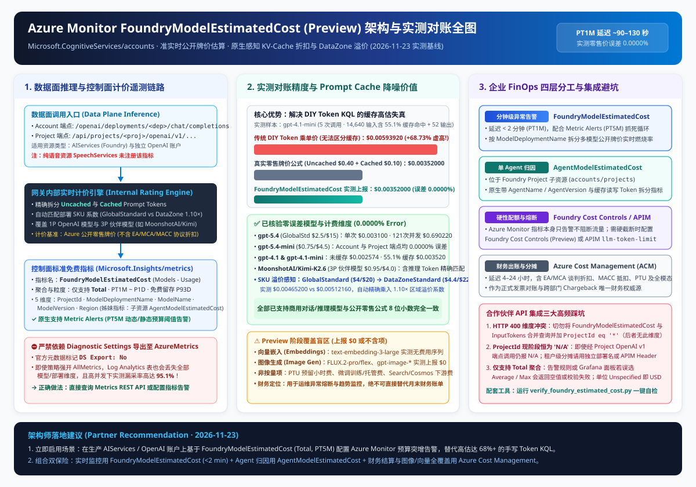
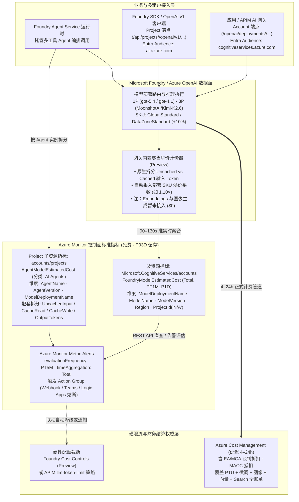

# Azure Monitor `FoundryModelEstimatedCost` (Preview) 架构、实测精度与合作伙伴决策指南

[English](foundry-model-estimated-cost-guide.en.md) | [仓库首页](README.md) | [交互式 FinOps 缓存误差模拟器](workshops/foundry-estimated-cost/calculator.html) | [合作伙伴自检脚本](workshops/foundry-estimated-cost/verify_foundry_estimated_cost.py) | [Foundry Local 端侧指南](foundry-local-on-device-ai-guide.md) | [既有 AOAI 配置手册](azure-foundry-aoai-guide.md)

> **核验基线与脱敏声明（2026-11-23）：** 本文基于 Microsoft Learn 官方指标参考文档，并结合跨 4 个 Azure 区域（`eastus2`、`swedencentral`、`southeastasia`、`southindia`）对 `AIServices`（Microsoft Foundry）与独立 `OpenAI` 资源的真实控制面/数据面实测结果整理而成。所有实测样本均严格脱敏，仅保留公开商用模型型号、公开零售单价与精确到小数点后 8 位的实测数值，不包含任何订阅 ID、租户 ID、内部资源名称或非公开代号。

## 导航

[1. 核心结论与可用度速览](#executive-summary) · [2. 控制面与数据面遥测架构](#architecture) · [3. 实测精度对账矩阵 (2026-11-23)](#empirical-matrix) · [4. 六大工程踩坑与规避方案](#pitfalls) · [5. 企业 FinOps 四类工具横向对比](#comparison) · [6. 合作伙伴场景选型矩阵与告警模板](#decision-matrix) · [7. 交付前自检清单](#checklist) · [8. 官方参考文档](#sources)

---

<a id="executive-summary"></a>
## 1. 核心结论与可用度速览

当合作伙伴询问 **“`FoundryModelEstimatedCost` 目前可用度如何？算得准不准？能不能用来做生产计费或预算告警？”** 时，AI 解决方案架构师可直接给出以下四点明确结论：

1. **可用度（已全面注册，开箱免配）：** 该指标属于 Azure Monitor **标准免费平台指标**（命名空间 `Microsoft.CognitiveServices/accounts`，分类 `Models - Usage`，保留期 **93 天 `P93D`**），已在多区域 **`AIServices`（Foundry 资源）与独立 `OpenAI` 资源**上默认就绪（纯语音资源 `SpeechServices` 不注册该指标），**PT1M 入库延迟仅约 `90–130 秒`（`< 2 分钟`）**，远快于 Azure Cost Management 的 `4–24 小时` 出账延迟。
2. **核心杀手锏（原生感知 Prompt KV-Cache 折扣与 SKU 溢价）：** 传统手写 KQL 用账户级 `InputTokens × 输入单价` 估算成本时，由于平台指标 `InputTokens` **不拆分缓存命中 Token**，在高缓存命中场景下会产生严重高估（实测 `gpt-4.1-mini` 在 `55.1%` 缓存命中率下，手写公式虚高 **`+68.73%`**）。而 `FoundryModelEstimatedCost` 由网关内部计价引擎直接输出，对 **1P OpenAI 模型、3P 合作伙伴模型（如 `MoonshotAI/Kimi-K2.6`）、KV-Cache 折扣以及 `DataZoneStandard` `+10%`（`1.10×`）SKU 溢价** 均达到 **`0.0000%` 零售公式误差**。
3. **Preview 阶段三大硬边界（绝不可直接替代财务账单）：**
   - **模态盲区：** 实测 **向量嵌入（`text-embedding-3-large`）** 与 **图像生成（`FLUX.2-pro`、`FLUX.2-flex`、`gpt-image-*`）** 目前均上报 `$0`（无指标序列）；不含 PTU 预留小时费、微调训练/托管费及下游 AI Search / Cosmos DB 费用。
   - **计价基准：** 仅按 **Azure 公开零售牌价（Retail List Price）** 计算，不感知企业 EA / MCA 谈判折扣或 MACC 承诺抵扣。
   - **`ProjectId` 维度限制：** 尽管指标定义了 `ProjectId` 维度，但实测无论走 Account 端点还是 Foundry Project OpenAI v1 端点（`/api/projects/<project>/openai/v1/chat/completions`），当前账户级指标中的 `ProjectId` 仍返回 `'N/A'`。若需按单 Agent 归因，请改查 Foundry Project 子资源上的姊妹指标 **`AgentModelEstimatedCost`**。
4. **最佳工程定位：** **立即用于生产环境“分钟级异常燃烧率监控 + Azure Monitor 预算突增告警（防 Agent 死循环/流量盗刷）”**，并与 **Foundry Cost Controls / APIM 限流策略**（硬熔断）及 **Azure Cost Management**（月末正式财务出账与多模态全覆盖）组合使用。

### 1.1 `Microsoft.Insights/metricDefinitions` 实测技术规格卡

| 属性项 | 实测返回值 (`api-version=2024-02-01`) | 工程含义与集成要点 |
| --- | --- | --- |
| **资源命名空间 (Namespace)** | `Microsoft.CognitiveServices/accounts` | 适用于 `kind: AIServices` 与 `kind: OpenAI`；**不支持** `kind: SpeechServices` |
| **指标名称与显示名** | `FoundryModelEstimatedCost` / `Foundry Model Estimated Cost (Preview)` | 归属指标分类 `Models - Usage` |
| **计费层级与留存期** | 标准平台指标（`Advanced: No` · **免费**）· 留存 `P93D`（93 天） | 无需开启付费高级监控即可直接拉取 93 天历史日/小时/分钟序列 |
| **单位与聚合方式** | `Unit: Unspecified`（实际代表 **USD 美元**）· **仅支持 `Total`** | `Average` / `Min` / `Max` / `Count` 均不支持，告警与面板必须显式指定 `Total` |
| **支持时间粒度 (`timeGrain`)** | `PT1M`, `PT5M`, `PT15M`, `PT30M`, `PT1H`, `PT6H`, `PT12H`, `P1D` | 实测单次推理完成后 **`~90–130 秒`** 即可在 `PT1M` 桶读到非零美金值 |
| **支持切分维度 (`dimensions`)** | `ProjectId`, `ModelDeploymentName`, `ModelName`, `ModelVersion`, `Region` | 生产推荐按 `ModelDeploymentName` 与 `ModelName` 切分；`ProjectId` 当前实测为 `'N/A'` |
| **诊断设置导出 (`DS Export`)** | **`No`（不支持导出至 `AzureMetrics`）** | 即使 Azure Policy 强制开启 `AllMetrics` 写入 Log Analytics，也会丢维度且高并发漏采达 `95.1%` |



---

<a id="architecture"></a>
## 2. 控制面与数据面遥测架构

### 2.1 数据面推理计价与控制面监控告警分工流向图



---

<a id="empirical-matrix"></a>
## 3. 实测精度对账矩阵 (2026-11-23)

我们在跨区域生产级 `AIServices` 与 `OpenAI` 账户上，针对**未缓存单次探针、121 次高并发批处理、Foundry Project OpenAI v1 端点、55.1% Prompt KV-Cache 命中、第三方合作伙伴推理模型（含思维链 Token）、`DataZoneStandard` 区域溢价，以及向量/生图模态**进行了逐笔实测核对。

### 3.1 商用模型与多模态实测记分卡

| 测试场景与模型版本 | 部署 SKU 与公开零售单价 (USD / 1M Tokens) | 实测调用量与 Token 明细 | 零售牌价理论值 (Expected USD) | `FoundryModelEstimatedCost` 实测上报值 | 相对误差与关键验证结论 |
| --- | --- | --- | --- | --- | --- |
| **1. `gpt-5.4` 单次无缓存探针**<br>(`2026-03-05`) | `GlobalStandard`<br>输入 `$2.50` · 输出 `$15.00` | `1` 次请求<br>`940` in + `50` out | `$0.00310000` | **`$0.00310000`** | **`0.0000%` 误差**；推理后约 `105 秒` 在 `PT1M` 桶精确入库 |
| **2. `gpt-5.4` 多请求并发压测**<br>(`2026-03-05`) | `GlobalStandard`<br>输入 `$2.50` · 输出 `$15.00` | `121` 次请求<br>`214,204` in + `10,314` out | `$0.69022000` | **`$0.69022000`** | **`0.0000%` 误差**；REST API `Total` 聚合零丢点（对比 `AzureMetrics` 表严重漏采） |
| **3A. `gpt-5.4-mini` 账户端点**<br>(`2026-03-17` · Account URL) | `GlobalStandard`<br>输入 `$0.75` · 输出 `$4.50` | `1` 次请求<br>`941` in + `60` out | `$0.00097575` | **`$0.00097575`** | **`0.0000%` 误差**；精确保留至微美分（小数点后 8 位） |
| **3B. `gpt-5.4-mini` Project 端点**<br>(`2026-03-17` · `/api/projects/<p>/openai/v1`) | `GlobalStandard`<br>输入 `$0.75` · 输出 `$4.50` | `1` 次请求（`ai.azure.com` 令牌）<br>`938` in + `50` out | `$0.00092850` | **`$0.00092850`** | **`0.0000%` 误差**；但返回元数据中 **`ProjectId` 仍为 `'N/A'`** |
| **4. `gpt-4.1` 标准对话探针**<br>(`2025-04-14`) | `GlobalStandard`<br>输入 `$2.00` · 输出 `$8.00` | `1` 次请求<br>`1,087` in + `50` out | `$0.00257400` | **`$0.00257400`** | **`0.0000%` 误差** |
| **5. `gpt-4.1-mini` Prompt 缓存命中**<br>(`2025-04-14` · **55.1% Cache Hit**) | `GlobalStandard`<br>未缓存输入 `$0.40` · **缓存输入 `$0.10`** · 输出 `$1.60` | `5` 次连续请求：总 `InputTokens = 14,640`（`6,576` 未缓存 + `8,064` 缓存）+ `52` out | 缓存感知真值：**`$0.00352000`**<br>*(手写 DIY 粗算：`$0.00593920`)* | **`$0.00352000`** | **`0.0000%` 误差！** 证明底层原生扣减 75% 缓存折扣，彻底消除手写 KQL **`+68.73%`** 的虚高失真 |
| **6. `MoonshotAI/Kimi-K2.6` (3P 模型)**<br>(`2026-04-20` · Foundry Partner) | `GlobalStandard`<br>输入 `$0.95` · 输出 `$4.00` | `1` 次请求<br>`797` in + `60` out（含 `60` 推理 Token） | `$0.00099715` | **`$0.00099715`** | **`0.0000%` 误差**；非 OpenAI 的第三方托管推理模型同样完整计价（含 Reasoning Tokens） |
| **7A. SKU 对照基准 (`GlobalStandard`)**<br>（同区域 `eastus2` 同模型版本） | `GlobalStandard`<br>输入 `$4.00` · 输出 `$20.00` | `1` 次请求<br>`938` in + `45` out | `$0.00465200` | **`$0.00465200`** | **`0.0000%` 误差**；作为同模型 `DataZoneStandard` 溢价对照组 |
| **7B. SKU 溢价对照 (`DataZoneStandard`)**<br>（同区域 `eastus2` 同模型版本） | `DataZoneStandard` (**`+10%`**)<br>输入 `$4.40` · 输出 `$22.00` | `1` 次请求<br>`939` in + `45` out | `$0.00512160` | **`$0.00512160`** | **`0.0000%` 误差**；原生识别部署 SKU 并精确乘以 **`1.10×`** 数据驻留区单价 |
| **8. 向量嵌入 (`text-embedding-3-large`)** | 向量模型按 Token 计费 | `2` 次调用 · `InputTokens = 994` | `> $0` | **`$0`（无指标序列）** | **Preview 盲区：** `InputTokens` 正常记账，但 `FoundryModelEstimatedCost` 不产出数据 |
| **9. 图像生成 (`FLUX.2-pro` / `FLUX.2-flex` / `gpt-image-*`)** | 按张数 / 图像 Token 计费 | 30 天内 `307` 次请求 / `39` 张图 | `> $0` | **`$0`（无指标序列）** | **Preview 盲区：** 多模态生图支出须从 Azure Cost Management 获取 |

### 3.2 为什么说“原生感知 KV-Cache 折扣”是该指标最大的工程价值？

在没有 `FoundryModelEstimatedCost` 之前，许多合作伙伴在 Grafana 或 Log Analytics 中编写自定义公式来监控实时花费：

$$\text{Naive DIY Cost} = \frac{\text{InputTokens} \times P_{\text{in}} + \text{OutputTokens} \times P_{\text{out}}}{1,000,000}$$

**致命缺陷在于：** `Microsoft.CognitiveServices/accounts` 命名空间下的平台指标只有总 `InputTokens` 和 `OutputTokens`，**没有任何独立维度或兄弟指标用来拆分 `cached_tokens`**。在长系统提示词（System Prompt）、多轮 Agent 工具调用或大型代码库上下文中，Prompt Cache 命中率普遍在 `50%–85%` 之间，而缓存命中部分的输入单价通常是未缓存单价的 `25%`（75% 折扣）甚至 `10%`（90% 折扣）。

以上表实测项 #5（`gpt-4.1-mini`）为例：
- **未拆分缓存的手写公式：** $(14,640 \times 0.40 + 52 \times 1.60) / 10^6 = \$0.00593920$（**虚高 `+68.73%`**，若缓存命中率升至 `80%`，虚高幅度将超过 **`+140%`**，导致预算告警频繁误报）。
- **缓存感知真实零售公式：** $(6,576 \times 0.40 + 8,064 \times 0.10 + 52 \times 1.60) / 10^6 = \$0.00352000$。
- **`FoundryModelEstimatedCost` 实测值：** **`$0.00352000`**，分毫不差。读者可打开配套的 [交互式 FinOps 缓存误差模拟器](workshops/foundry-estimated-cost/calculator.html) 拖入自身业务的缓存命中率与日调用量，直观查看手写公式的年化误报偏差。

---

<a id="pitfalls"></a>
## 4. 六大工程踩坑与规避方案 (Partner Pitfalls & Workarounds)

在将 `FoundryModelEstimatedCost` 接入客户监控大盘、自动化脚本或告警规则时，请务必避开以下实测验证过的六个陷阱：

### 陷阱 1：合并查询 `FoundryModelEstimatedCost,InputTokens` 并携带 `ProjectId` 过滤器触发 `HTTP 400 BadRequest`
- **现象：** 调用 Azure Monitor Metrics REST API 时，将 `metricnames=FoundryModelEstimatedCost,InputTokens,OutputTokens` 放在同一个请求中，并传入 `$filter=ProjectId eq '*' and ModelDeploymentName eq '*'`，服务端直接拒绝并返回 `HTTP 400 BadRequest`。
- **根因：** `FoundryModelEstimatedCost` 拥有 `ProjectId` 维度，而同命名空间下的 `InputTokens`、`OutputTokens`、`ModelRequests` **没有 `ProjectId` 维度**。Azure Monitor 禁止对不含该维度的指标应用维度通配过滤。
- **标准解法：** 拆分为**两次独立 HTTP 请求**（一次查 `FoundryModelEstimatedCost`，另一次查 `ModelRequests,InputTokens,OutputTokens`），或仅按共有维度 `ModelDeploymentName eq '*'` 过滤。本仓库的 [`verify_foundry_estimated_cost.py`](workshops/foundry-estimated-cost/verify_foundry_estimated_cost.py) 已内置安全拆分逻辑。

### 陷阱 2：指望依靠 `ProjectId` 维度做多项目/多部门精确成本分摊
- **现象：** 客户在一个共享 Foundry 资源（`AIServices`）下创建了多个 Foundry Project，并严格通过 Project 专属端点 `https://<account>.services.ai.azure.com/api/projects/<project>/openai/v1/chat/completions`（使用 `https://ai.azure.com` Entra 令牌）发起推理，但查出来的 `FoundryModelEstimatedCost` 序列中 `ProjectId` 依然全部显示为 `'N/A'`。
- **根因：** Preview 阶段无状态 OpenAI v1 聊天补全路径尚未将外层 Project 上下文回填至父账户指标的 `ProjectId` 维度。
- **标准解法：**
  1. **若走 Foundry Agent Service：** 直接查询 Foundry Project 子资源（`Microsoft.CognitiveServices/accounts/projects`）上的 **`AgentModelEstimatedCost`**，按 `AgentName` 与 `AgentVersion` 精确归因。
  2. **若走直接模型推理 API：** 为不同业务部门创建命名规范的独立部署（如 `dept-fin-gpt-41-mini`，利用 `ModelDeploymentName` 维度拆分），或前置 **Azure API Management (APIM) AI Gateway** 按订阅 Key / JWT Claim 记录细粒度 Token 账本，并在资源级启用 [Foundry 项目成本视图指南](https://learn.microsoft.com/en-us/azure/foundry/how-to/view-project-costs) 中的标签与项目核算方案。

### 陷阱 3：通过 Diagnostic Settings 将指标导入 Log Analytics `AzureMetrics` 表后做 KQL 汇总
- **现象：** 安全合规团队通过 Azure Policy 统一为所有 Cognitive Services 开启了 `AllMetrics -> Log Analytics Workspace`，随后工程师在 `AzureMetrics | where MetricName == "FoundryModelEstimatedCost"` 中写 KQL，发现**既看不到 `ModelDeploymentName` 维度，汇总金额也只有真实值的零头**。
- **根因：** 官方指标参考明确标注 `FoundryModelEstimatedCost` 的 **`DS Export = No`**。在实测高并发窗口内，`AzureMetrics` 表不仅剥离了全部 5 个业务维度，还丢弃了高达 **`95.1%`** 的分钟级数据点！
- **标准解法：** **严禁使用 `AzureMetrics` 表统计该指标。** 报表与巡检脚本请直接调用 `Microsoft.Insights/metrics` REST API / Azure Monitor Metrics Explorer / Managed Grafana Azure Monitor 数据源；告警请直接使用原生 **Metric Alerts**（底层直接评估时间序列库，不经过 Log Analytics）。

### 陷阱 4：在告警或图表中误选 `Average` / `Max` 聚合，或疑惑单位 `Unspecified`
- **现象：** 在 Terraform / Bicep / Grafana 中配置默认 `Average` 聚合时报错或曲线恒为空；查看原始 JSON 发现 `"unit": "Unspecified"`。
- **标准解法：** 该指标仅支持 **`Total` 唯一聚合类型**（`supportedAggregationTypes: ["Total"]`），数值含义固定为 **美金（USD，按公开零售价计）**。在 Bicep/ARM 告警规则中务必写死 `"timeAggregation": "Total"`。

### 陷阱 5：对包含大量生图（FLUX / GPT-Image）或大规模向量化（Embeddings）的账户单靠该指标设总预算防线
- **现象：** 营销团队高频调用 `FLUX.2-pro` 生成海报，或知识库夜间全量重跑 `text-embedding-3-large` 向量化，`FoundryModelEstimatedCost` 依然显示 `$0.00`。
- **标准解法：** 对多模态与向量工作负载，需同时对 `ModelRequests` / `InputTokens`（针对向量部署名）设置调用量突增告警，并在 **Azure Cost Management Budgets** 中设置账户级日/月实际账单预算兜底。

### 陷阱 6：将 `FoundryModelEstimatedCost` 月度累加值直接发给客户财务作为结算单
- **现象：** MSP 合作伙伴直接把 30 天 `FoundryModelEstimatedCost` 总和当作账单金额报给拥有 EA 折扣或 PTU 预留的企业客户，引发对账差异。
- **标准解法：** 向客户明确声明该数值为 **“按量（PAYG）对话/推理模型的公开零售牌价实时估算（Estimated Retail Run-Rate）”**，用于工程侧分钟级熔断与相对趋势对比；财务结算与折扣后分摊始终以 **Azure Cost Management** 为准。

---

<a id="comparison"></a>
## 5. 企业 FinOps 四类工具横向对比

没有单一工具能同时做到“秒级延迟 + 硬性截断 + 含企业谈判折扣 + 覆盖所有下游云资源”。成熟的企业级 Foundry FinOps 治理需要按职责组合以下五种能力：

| 对比维度 | `FoundryModelEstimatedCost` (本文主角 · Preview) | Project 子资源 `AgentModelEstimatedCost` | Foundry Cost Controls (Preview) / APIM 限流 | Azure Cost Management (ACM) | 手写 DIY Token KQL (`InputTokens × 单价`) |
| --- | --- | --- | --- | --- | --- |
| **资源层级与入口** | 父账户 `Microsoft.CognitiveServices/accounts` 平台指标 | 子资源 `Microsoft.CognitiveServices/accounts/projects` 指标 (`AI Agents`) | Foundry 门户成本控制策略 / APIM `llm-token-limit` | 订阅 / 资源组 / 资源 / Tag 计费中心 | Azure Monitor 或网关日志手工乘单价 |
| **数据可见延迟** | **准实时 `~90–130 秒`** (`PT1M`) | **准实时分钟级** (`PT1M`) | **实时拦截**（网关内毫秒级计数或准实时配额） | 慢（通常 **`4–24 小时`** 账单管道延迟） | 准实时（`1–5 分钟`） |
| **Prompt 缓存折扣感知** | **✅ 原生精确感知**（实测 `0.0000%` 误差） | **✅ 原生感知**（并额外提供 `CacheRead` / `CacheWrite` / `Uncached` Token 指标） | 取决于具体配额策略（APIM 默认按总 Token 限流） | **✅ 真实账单精确感知** | **❌ 平台指标无法区分缓存**（实测虚高 `+68.73%+`） |
| **SKU 溢价与 3P 模型** | **✅ 自动识别** `DataZoneStandard` (`1.10×`) 及 Kimi 等 3P 模型 | **✅ 自动识别** Agent 绑定的底层部署费率 | 支持按部署或路由策略隔离 | **✅ 完整覆盖**全部商用计量表 | ❌ 需人工维护复杂单价字典，模型升级易算错 |
| **模态与费用覆盖范围** | 仅支持已接入的 PAYG 对话/推理模型；**不含向量、生图、PTU、微调** | 仅限经由 **Foundry Agent Service** 执行的模型消耗 | 仅限受控端点流量 | **✅ 100% 全覆盖**（含生图、向量、PTU、微调、AI Search、Cosmos DB） | 仅限能拿到 Token 数的文本接口 |
| **EA / MCA 协议折扣** | ❌ 不含（纯公开零售牌价） | ❌ 不含（纯公开零售牌价） | ❌ 不含 | **✅ 唯一权威包含**谈判折扣、税费与 MACC | ❌ 不含（除非硬编码商业机密折扣率） |
| **能否主动阻断超支流量** | 仅监控与触发告警（需配合 Action Group 调脚本/Webhook） | 仅监控与触发告警 | **✅ 原生硬阻断**（超限直接返回 `HTTP 429` 保护预算） | 默认仅邮件/Webhook 预算通知 | 仅事后查询告警 |

---

<a id="decision-matrix"></a>
## 6. 合作伙伴场景选型矩阵与告警模板

### 6.1 合作伙伴常见需求选型决策表

| 合作伙伴 / 客户核心诉求 | 推荐首选方案 | 架构实施要点 |
| --- | --- | --- |
| **“开发测试或生产 Agent 出现死循环，希望 5 分钟内收到钉钉/Teams/邮件美金突增告警”** | **`FoundryModelEstimatedCost` + Azure Monitor Metric Alert (`PT5M`)** | 按 `ModelDeploymentName` 切分维度，设置每 5 分钟 `Total > $X`（如 `$5.00`）静态或动态阈值告警，彻底告别等次日 ACM 账单才发现跑掉几千美金的痛点 |
| **“重度使用长 System Prompt 与多轮上下文，之前手写 Token 监控老是比真实账单高出一大截”** | **直接切换至 `FoundryModelEstimatedCost`** | 无需修改业务代码上传应用层 `cached_tokens` 日志，直接利用平台指标内置的 KV-Cache 折扣计价消除 `+68%+` 虚高噪音 |
| **“同一个 Foundry Project 里跑了客服、法务、财报 3 个托管 Agent，想看每个 Agent 花了多少钱”** | **`AgentModelEstimatedCost`（Project 子资源指标）** | 查询 `Microsoft.CognitiveServices/accounts/<acc>/projects/<proj>` 下的 `AI Agents` 分类指标，按 `AgentName`、`AgentVersion` 聚合，并结合 `AgentModelCacheReadTokens` 优化提示词缓存率 |
| **“ISV SaaS 平台多租户共享同一批模型部署，需要给每个外部租户设置硬性日消费上限并实时扣减”** | **前置 APIM AI Gateway + 应用层 `usage` 账本 + Foundry Cost Controls** | 不要依赖当前返回 `'N/A'` 的 `ProjectId`；在网关或服务端直接解析每次 HTTP 响应体中的 `usage.prompt_tokens_details.cached_tokens` 记入租户 Redis 账本并执行毫秒级熔断 |
| **“月末向客户出具正式 MSP 托管账单，包含 FLUX 生图、向量库、PTU 预留与客户专属 MCA 折扣”** | **Azure Cost Management Exports + FinOps FOCUS 数据集** | 以 ACM 实际出账数据为唯一财务结算源；可将 `FoundryModelEstimatedCost` 作为日内运营健康度参考指标并列展示 |

### 6.2 经 ARM `deployment group validate` 实测通过的分钟级预算突增告警模板

以下 ARM / JSON 资源定义已通过控制面部署校验（`Succeeded`），可直接嵌入合作伙伴的基础设施即代码（IaC）流水线，对任意部署每 5 分钟累计估算花费超过 `$10.00 USD` 触发告警：

```json
{
  "$schema": "https://schema.management.azure.com/schemas/2019-04-01/deploymentTemplate.json#",
  "contentVersion": "1.0.0.0",
  "parameters": {
    "alertName": {
      "type": "string",
      "defaultValue": "alert-foundry-5min-estimated-cost-spike"
    },
    "foundryAccountResourceId": {
      "type": "string",
      "metadata": {
        "description": "Full ARM ID of Microsoft.CognitiveServices/accounts/<name>"
      }
    },
    "actionGroupResourceId": {
      "type": "string",
      "metadata": {
        "description": "Full ARM ID of Microsoft.Insights/actionGroups/<name>"
      }
    },
    "fiveMinuteUsdThreshold": {
      "type": "int",
      "defaultValue": 10
    }
  },
  "resources": [
    {
      "type": "Microsoft.Insights/metricAlerts",
      "apiVersion": "2018-03-01",
      "name": "[parameters('alertName')]",
      "location": "global",
      "properties": {
        "description": "Near-real-time retail USD burn-rate guardrail per model deployment (FoundryModelEstimatedCost Preview).",
        "severity": 2,
        "enabled": true,
        "scopes": [
          "[parameters('foundryAccountResourceId')]"
        ],
        "evaluationFrequency": "PT5M",
        "windowSize": "PT5M",
        "criteria": {
          "odata.type": "Microsoft.Azure.Monitor.MultipleResourceMultipleMetricCriteria",
          "allOf": [
            {
              "criterionType": "StaticThresholdCriterion",
              "name": "PerDeploymentRetailCostSpike",
              "metricNamespace": "Microsoft.CognitiveServices/accounts",
              "metricName": "FoundryModelEstimatedCost",
              "timeAggregation": "Total",
              "operator": "GreaterThan",
              "threshold": "[parameters('fiveMinuteUsdThreshold')]",
              "dimensions": [
                {
                  "name": "ModelDeploymentName",
                  "operator": "Include",
                  "values": [
                    "*"
                  ]
                }
              ]
            }
          ]
        },
        "actions": [
          {
            "actionGroupId": "[parameters('actionGroupResourceId')]"
          }
        ]
      }
    }
  ]
}
```

### 6.3 三步运行本仓库零密钥合作伙伴自检脚本

本仓库提供了仅依赖 Python 标准库与 `az login`（全程使用 Microsoft Entra ID 令牌，零硬编码密钥）的一键核验工具 [`workshops/foundry-estimated-cost/verify_foundry_estimated_cost.py`](workshops/foundry-estimated-cost/verify_foundry_estimated_cost.py)：

```powershell
# 1. 登录目标 Azure 订阅
az login

# 2. 零推理成本模式：检查控制面指标定义 + 过去 7 天各部署估算花费与 Token 对比
python workshops\foundry-estimated-cost\verify_foundry_estimated_cost.py `
  --resource-id "/subscriptions/<sub-id>/resourceGroups/<rg>/providers/Microsoft.CognitiveServices/accounts/<account>" `
  --days 7

# 3. 可选端到端实测探针（发送 1 条极低成本请求，自动轮询 PT1M 桶并校验零售牌价误差）
python workshops\foundry-estimated-cost\verify_foundry_estimated_cost.py `
  --resource-id "/subscriptions/<sub-id>/resourceGroups/<rg>/providers/Microsoft.CognitiveServices/accounts/<account>" `
  --endpoint "https://<account>.cognitiveservices.azure.com" `
  --deployment "gpt-4.1-mini" `
  --input-price-per-1m 0.40 --cached-input-price-per-1m 0.10 --output-price-per-1m 1.60
```

---

<a id="checklist"></a>
## 7. 交付前自检清单 (Partner Verification Checklist)

在向客户交付基于 `FoundryModelEstimatedCost` 的监控大盘或 FinOps 治理方案前，请逐项确认：

- [ ] **1. 资源类型核对：** 目标资源确认为 `Microsoft.CognitiveServices/accounts` 且 `kind` 为 `AIServices` 或 `OpenAI`（非 `SpeechServices`）。
- [ ] **2. 独立 REST 查询隔离：** 自动化拉取脚本已将 `FoundryModelEstimatedCost` 与 `InputTokens`/`OutputTokens` 拆分为独立查询，避免因 `ProjectId` 维度缺失导致 `HTTP 400 BadRequest`。
- [ ] **3. 强制 `Total` 聚合：** 所有 Azure Monitor 图表、Managed Grafana 面板及 Metric Alerts 均显式配置 `aggregation = Total`（严禁使用 `Average` / `Max`）。
- [ ] **4. 禁用 `AzureMetrics` 日志表统计：** 成本大盘直接读取 Azure Monitor Metrics 时间序列 API，不依赖丢维度且高并发漏采的 Diagnostic Settings `AzureMetrics` 表。
- [ ] **5. 多租户 / 多项目拆分绕行方案已就绪：** 知晓当前无状态推理路径下 `ProjectId` 返回 `'N/A'`；已通过独立 `ModelDeploymentName`、APIM AI Gateway 或 Foundry Agent Service 子资源指标 `AgentModelEstimatedCost` 完成细粒度归因。
- [ ] **6. 多模态与 PTU 盲区补齐：** 若业务包含 Embeddings（如 `text-embedding-3-large`）、图像生成（如 `FLUX.2-pro` / `gpt-image-*`）、PTU 或微调，已同步配置调用量监控与 Azure Cost Management 账户预算。
- [ ] **7. 硬限流与软告警联动：** 明确知晓 Azure Monitor 指标告警本身不会阻断请求；高风险外网或沙盒环境已同步启用 Foundry Cost Controls (Preview) 或 APIM 速率/配额限制。
- [ ] **8. 财务口径免责对齐：** 监控面板标题明确标注 **“Estimated Retail USD (Preview · 不含 EA/MCA/MACC 协议折扣)”**，月末财务对账统一指向 Azure Cost Management。

---

<a id="sources"></a>
## 8. 官方参考文档 (Official Microsoft Learn References)

1. **Azure Monitor Cognitive Services 支持指标全集（含 `FoundryModelEstimatedCost` 与 `AgentModelEstimatedCost` 维度/聚合/DS Export 定义）：** [Microsoft.CognitiveServices/accounts supported metrics](https://learn.microsoft.com/en-us/azure/azure-monitor/reference/supported-metrics/microsoft-cognitiveservices-accounts-metrics)
2. **Azure OpenAI 监控指标与遥测参考：** [Monitor Azure OpenAI reference — Metrics](https://learn.microsoft.com/en-us/azure/foundry/openai/monitor-openai-reference#metrics)
3. **Microsoft Foundry 成本规划与管理总览：** [Plan and manage costs for Microsoft Foundry](https://learn.microsoft.com/en-us/azure/foundry/concepts/manage-costs)
4. **按 Foundry Project 查看与分摊成本操作指南：** [View costs for a Microsoft Foundry project](https://learn.microsoft.com/en-us/azure/foundry/how-to/view-project-costs)
5. **Foundry Cost Controls (Preview) 概念与硬限额机制：** [Cost controls in Microsoft Foundry](https://learn.microsoft.com/en-us/azure/foundry/concepts/cost-controls)
6. **配置 Foundry Cost Controls 实操步骤：** [Create and manage cost controls](https://learn.microsoft.com/en-us/azure/foundry/how-to/create-cost-controls)
7. **Microsoft Foundry 计费模型、SKU 与计量概念：** [Billing concepts in Microsoft Foundry](https://learn.microsoft.com/en-us/azure/foundry/concepts/billing-concepts)
